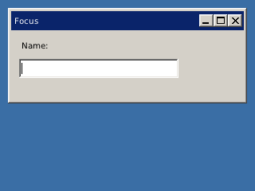

<!-- AUTOGENERATED COPYRIGHT HEADER START -->
<!-- Copyright (C) 2026 Claude <noreply@anthropic.com> -->
<!-- AUTOGENERATED COPYRIGHT HEADER END -->
<!-- Generated by tools/wiki/wiki.py. Edit tools/wiki/text/ instead of this file. -->


# ActivateGadget

<div align="center">

[Command Index](Command-Index) · [BlitzPlus](BlitzPlus) · [Gadgets](BlitzPlus-Gadgets)

</div>


```blitzbasic
ActivateGadget gadget:Int32
```

| Parameter | Type | Default | Description |
|---|---|---|---|
| `gadget` | Int32 | required | Handle of the gadget that should get the focus. |

## Description

Gives the keyboard focus to a gadget, so that typing goes to it. Use it to put the cursor in a text field when a window opens. Giving the focus to the window itself makes keys like Escape reach the window again.

## Examples

```blitzbasic
Graphics 320, 240, 32, 2
win = CreateWindow("Focus", 10, 10, 300, 120, Desktop(), 3)
CreateLabel "Name:", 10, 10, 120, 24, win
name = CreateTextField(10, 36, 200, 24, win)
ActivateGadget name
Repeat
Until WaitEvent() = $803
```

## Media



## Related Commands

[AddGadgetItem](AddGadgetItem), [ClearGadgetItems](ClearGadgetItems), [CountGadgetItems](CountGadgetItems), [DisableGadget](DisableGadget), [EnableGadget](EnableGadget), [FreeGadget](FreeGadget), [HideGadget](HideGadget), [ShowGadget](ShowGadget)

<div align="center">

[Command Index](Command-Index) · [BlitzPlus](BlitzPlus) · [Gadgets](BlitzPlus-Gadgets)

</div>
