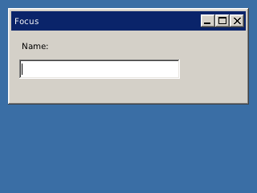

<!-- AUTOGENERATED COPYRIGHT HEADER START -->
<!-- Copyright (C) 2026 Claude <noreply@anthropic.com> -->
<!-- AUTOGENERATED COPYRIGHT HEADER END -->
<!-- Generated by tools/wiki/wiki.py. Edit tools/wiki/text/ instead of this file. -->
# ActivateGadget 

<div align="center">

[Command Index](Command-Index) · [BlitzPlus](BlitzPlus) · [Gadgets](BlitzPlus-Gadgets)

</div>


```blitzbasic
ActivateGadget:Void gadget:Int32
```

| Parameter | Mode | Type | Default | Description |
|---|---|---|---|---|
| `gadget` | In | Int32 | required | Handle of the gadget that should get the focus. |

## Description

Gives the keyboard focus to a gadget, so that typing goes to it. Use it to put the cursor in a text field when a window opens. Giving the focus to the window itself makes keys like Escape reach the window again.

## Examples

```blitzbasic
Graphics 320, 240, 32, 2
win = CreateWindow("Focus", 10, 10, 300, 120, Desktop(), 3)
CreateLabel "Name:", 10, 10, 120, 24, win
name = CreateTextField(10, 36, 200, 24, win)
ActivateGadget name
Repeat
Until WaitEvent() = $803
```

## Media



## Related Commands

[AddGadgetItem](AddGadgetItem) , [ClearGadgetItems](ClearGadgetItems) , [CountGadgetItems](CountGadgetItems) , [DisableGadget](DisableGadget) , [EnableGadget](EnableGadget) , [FreeGadget](FreeGadget) , [HideGadget](HideGadget) , [ShowGadget](ShowGadget) 

<div align="center">

[Command Index](Command-Index) · [BlitzPlus](BlitzPlus) · [Gadgets](BlitzPlus-Gadgets)

</div>
