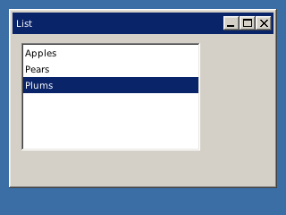

<!-- AUTOGENERATED COPYRIGHT HEADER START -->
<!-- Copyright (C) 2026 Claude <noreply@anthropic.com> -->
<!-- AUTOGENERATED COPYRIGHT HEADER END -->
<!-- Generated by tools/wiki/wiki.py. Edit tools/wiki/text/ instead of this file. -->
# AddGadgetItem 

<div align="center">

[Command Index](Command-Index) · [BlitzPlus](BlitzPlus) · [Gadgets](BlitzPlus-Gadgets)

</div>


```blitzbasic
AddGadgetItem:Void gadget:Int32, item:String, select:Int32=0, icon:Int32=-1
```

| Parameter | Mode | Type | Default | Description |
|---|---|---|---|---|
| `gadget` | In | Int32 | required | Handle of a list box, combo box or tabber. |
| `item` | In | String | required |  |
| `select` | In | Int32 | `0` | True makes it the selected entry. Defaults to False. |
| `icon` | In | Int32 | `-1` | Number of an icon in the icon strip given with [SetGadgetIconStrip](SetGadgetIconStrip). Defaults to -1, which means none. |

## Description

Adds an entry at the end of a list box, combo box or tabber. For a tabber the entry is a new tab. Use [InsertGadgetItem](InsertGadgetItem) to put it somewhere else.

## Examples

```blitzbasic
Graphics 320, 240, 32, 2
win  = CreateWindow("List", 10, 10, 300, 200, Desktop(), 3)
list = CreateListBox(10, 10, 200, 120, win)
AddGadgetItem list, "Apples"
AddGadgetItem list, "Pears"
AddGadgetItem list, "Plums", True
Repeat
Until WaitEvent() = $803
```

## Media



## Related Commands

[ActivateGadget](ActivateGadget) , [ClearGadgetItems](ClearGadgetItems) , [GadgetItemText](GadgetItemText) , [InsertGadgetItem](InsertGadgetItem) , [ModifyGadgetItem](ModifyGadgetItem) , [RemoveGadgetItem](RemoveGadgetItem) , [SelectedGadgetItem](SelectedGadgetItem) , [SelectGadgetItem](SelectGadgetItem) 

<div align="center">

[Command Index](Command-Index) · [BlitzPlus](BlitzPlus) · [Gadgets](BlitzPlus-Gadgets)

</div>
