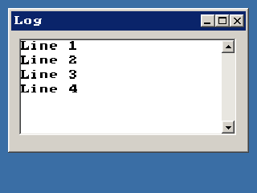

<!-- AUTOGENERATED COPYRIGHT HEADER START -->
<!-- Copyright (C) 2026 Claude <noreply@anthropic.com> -->
<!-- AUTOGENERATED COPYRIGHT HEADER END -->
<!-- Generated by tools/wiki/wiki.py. Edit tools/wiki/text/ instead of this file. -->


# AddTextAreaText

<div align="center">

[Command Index](Command-Index) · [BlitzPlus](BlitzPlus) · [Text Areas](BlitzPlus-Text-Areas)

</div>


```blitzbasic
AddTextAreaText:Void textarea:Int32, text:String
```

| Parameter | Mode | Type | Default | Description |
|---|---|---|---|---|
| `textarea` | In | Int32 | required | Handle of a text area. |
| `text` | In | String | required | Text to append. |

## Description

Appends text at the end of a text area, with the formatting of the text before it. Line breaks are made with `Chr$(13)` or `Chr$(13) + Chr$(10)`.

## Examples

```blitzbasic
Graphics 320, 240, 32, 2
win = CreateWindow("Log", 10, 10, 300, 180, Desktop(), 3)
log = CreateTextArea(10, 10, 270, 120, win)
For i = 1 To 4
	AddTextAreaText log, "Line " + i + Chr$(13)
Next
Repeat
Until WaitEvent() = $803
```

## Media



## Related Commands

[CreateTextArea](CreateTextArea), [FormatTextAreaText](FormatTextAreaText), [LockTextArea](LockTextArea), [SetTextAreaColor](SetTextAreaColor), [SetTextAreaFont](SetTextAreaFont), [SetTextAreaText](SetTextAreaText), [TextAreaText](TextAreaText), [TextFieldText](TextFieldText)

<div align="center">

[Command Index](Command-Index) · [BlitzPlus](BlitzPlus) · [Text Areas](BlitzPlus-Text-Areas)

</div>
