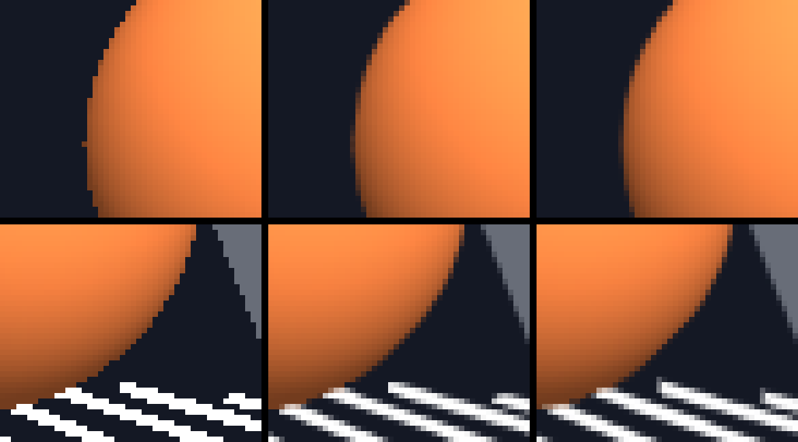

<!-- AUTOGENERATED COPYRIGHT HEADER START -->
<!-- Copyright (C) 2026 Claude <noreply@anthropic.com> -->
<!-- AUTOGENERATED COPYRIGHT HEADER END -->
<!-- Generated by tools/wiki/wiki.py. Edit tools/wiki/text/ instead of this file. -->


# AntiAlias

<div align="center">

[Command Index](Command-Index) · [Blitz3D](Blitz3D) · [World](Blitz3D-World)

</div>


```blitzbasic
AntiAlias:Void enable:Int32
```

| Parameter | Mode | Type | Default | Description |
|---|---|---|---|---|
| `enable` | In | Int32 | required | 0 (False) to switch it off, 1 (True) for SMAA, and 2 for SMAA T2x on the BackBuffer. Any value above 2 is 2. It is off by default, and can be changed between pictures. |

## Description

Switches anti-aliasing of 3D drawing on or off: the jagged edges of triangles, and of everything else that is hard-edged in the picture of a camera, are smoothed. BlitzLLVM does this with SMAA (Subpixel Morphological Antialiasing, by Jorge Jimenez, Jose I. Echevarria, Belen Masia, Fernando Navarro and Diego Gutierrez), at its ultra preset. It finds the edges in the picture after the camera drew it, and blends the pixels along them by how much of the pixel a smooth edge would cover, which also gets edges that are not between triangles: textures with sharp contrast, and the edges of sprites.

With 1 the picture of every camera is smoothed after RenderWorld drew it. It looks at the picture only, so it does not need a different buffer format, works the same in every color depth and for textures as targets, and a scene that is already smooth stays as it is. It does not find detail that is smaller than a pixel, a thin wire that is darker than a pixel is wide stays broken up.

With 2 (a BlitzLLVM extension) it is SMAA T2x, which takes a second sample: the picture of a camera is shifted by a quarter of a pixel, every other RenderWorld to the other side, and is blended with the picture of the RenderWorld before it. That finds detail that 1 can not, and makes thin lines and distant edges steadier, at the price of a little softness when the camera moves and a smear behind things that move fast. The picture before is moved by how the camera moved since, which is found from the depth of both pictures, so everything that stands still in the world lines up; things that move are kept from smearing by not letting the picture before have colors that are not in the neighborhood of the pixel. A camera that was not drawn by the RenderWorld before, or whose area changed size, starts again from the current picture. Because it needs the picture of the RenderWorld before, 2 falls back to 1 when the target is not the BackBuffer, such as a texture or an image buffer.

Only what the cameras draw is smoothed, in the part of the buffer that the camera draws to (CameraViewport), directly after the camera was drawn. 2D drawing, with Line, Rect, DrawImage, Text and the rest, is never smoothed, before or after RenderWorld; where a camera does not clear its picture (CameraClsMode), only what 3D drew and the pixels next to it are smoothed. It happens before the picture is shown. With [Dither](Dither) on, the last pass of it adds the noise to the colors that it makes between two steps of 8 bits (a blended edge, and the mix with the picture before for 2), so dithering is the last thing that is done to a pixel; the pixels that it does not change keep the noise that 3D drawing added to them, and a buffer of more than 8 bits per channel gets its noise when it is shown. Where the GPU's texture filtering rounds to whole steps (a software renderer does), the blend of 1 has nothing between two steps to dither. With the depth 8 of [Graphics3D](Graphics3D) there are only the colors of the palette to show, which a blend of two colors is not, so nothing is smoothed. With 0 nothing is done at all, which is the default: the picture is exactly what it was before, and no memory or time is used for it. It costs a few passes over the area of the camera: an edge pass, a pass for the weights and one for the blend, and for 2 one more, and the memory of a few pictures of the size of the camera.

The example draws a tilted cube and switches between the three modes with the keys 0, 1 and 2.

## Differences

* The original handed the setting to the graphics driver, where it did nothing on most hardware of the time. Here 1 smooths the picture of the cameras with SMAA, and 2 (SMAA T2x on the BackBuffer) is new.

## Examples

```blitzbasic
Graphics3D 320, 240, 0, 2
SetBuffer BackBuffer()
camera = CreateCamera()
CameraClsColor camera, 20, 20, 30
PositionEntity camera, 0, 0, -4

cube = CreateCube()
EntityColor cube, 230, 230, 230
TurnEntity cube, 20, 30, 0

mode = 1
AntiAlias mode
While Not KeyHit(1)
	For k = 0 To 2
		If KeyHit(2 + k) Then mode = k : AntiAlias mode
	Next
	TurnEntity cube, 0, 0.3, 0
	RenderWorld
	Text 4, 4, "AntiAlias " + mode
	Flip
Wend
```

Enlarged eight times, the edge of a sphere (top) and of thin bars (bottom) with AntiAlias 0, 1 and 2 from left to right:

## Media



## Related Commands

[ActiveTextures](ActiveTextures), [AmbientLight](AmbientLight), [CaptureWorld](CaptureWorld), [ClearWorld](ClearWorld)

<div align="center">

[Command Index](Command-Index) · [Blitz3D](Blitz3D) · [World](Blitz3D-World)

</div>
