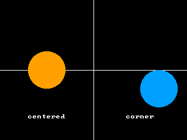

<!-- AUTOGENERATED COPYRIGHT HEADER START -->
<!-- Copyright (C) 2026 Claude <noreply@anthropic.com> -->
<!-- AUTOGENERATED COPYRIGHT HEADER END -->
<!-- Generated by tools/wiki/wiki.py. Edit tools/wiki/text/ instead of this file. -->


# AutoMidHandle

<div align="center">

[Command Index](Command-Index) · [BlitzBasic](BlitzBasic) · [Images](BlitzBasic-Images)

</div>


```blitzbasic
AutoMidHandle:Void enable:Int32
```

| Parameter | Mode | Type | Default | Description |
|---|---|---|---|---|
| `enable` | In | Int32 | required | True to center the handle of new images, False to put it in the top left corner (the default). |

## Description

Turns on or off the automatic centering of the handle of every image that is loaded, created or copied from now on. The handle is the point of an image that sits at the position given to [DrawImage](DrawImage). It starts in the top left corner. With AutoMidHandle on, it is in the middle of the image, which is what rotating and scaling sprites usually need. Images that already exist keep their handle.

## Examples

```blitzbasic
Graphics 320, 240, 0, 2
SetBuffer BackBuffer()
AutoMidHandle True
Local a = CreateImage(64, 64)
SetBuffer ImageBuffer(a)
Color 255, 160, 0
Oval 0, 0, 64, 64, 1
SetBuffer BackBuffer()
AutoMidHandle False
Local b = CreateImage(64, 64)
SetBuffer ImageBuffer(b)
Color 0, 160, 255
Oval 0, 0, 64, 64, 1
SetBuffer BackBuffer()
Cls
Color 255, 255, 255
Line 160, 0, 160, 239
Line 0, 120, 319, 120
DrawImage a, 80, 120
DrawImage b, 240, 120
Text 80, 200, "centered", 1, 1
Text 240, 200, "corner", 1, 1
Flip
WaitKey
```

## Media



## Related Commands

[HandleImage](HandleImage), [ImageXHandle](ImageXHandle), [ImageYHandle](ImageYHandle), [MidHandle](MidHandle)

<div align="center">

[Command Index](Command-Index) · [BlitzBasic](BlitzBasic) · [Images](BlitzBasic-Images)

</div>
