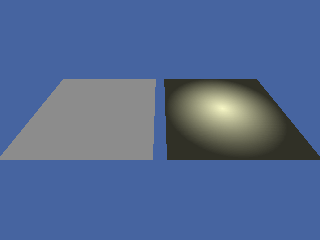

<!-- AUTOGENERATED COPYRIGHT HEADER START -->
<!-- Copyright (C) 2026 Claude <noreply@anthropic.com> -->
<!-- AUTOGENERATED COPYRIGHT HEADER END -->
<!-- Generated by tools/wiki/wiki.py. Edit tools/wiki/text/ instead of this file. -->


# BSPLighting

<div align="center">

[Command Index](Command-Index) · [Blitz3D](Blitz3D) · [BSP](Blitz3D-BSP)

</div>


```blitzbasic
BSPLighting:Void bsp:Int32, use_lightmaps:Int32
```

| Parameter | Mode | Type | Default | Description |
|---|---|---|---|---|
| `bsp` | In | Int32 | required | The level. |
| `use_lightmaps` | In | Int32 | required | True for lightmaps, False for vertex lighting. Defaults to True. |

## Description

Chooses between lightmaps and vertex lighting for a level. Vertex lighting is faster on some graphics cards but looks worse.

The example builds a level with one floor and a lightmap that has a bright spot in it, and shows it twice: the left one with vertex lighting, the right one with lightmaps.

## Differences

* The lightmaps are drawn as a second layer that multiplies what is below twice, as Quake stores them at half their brightness. Vertex lighting uses the colors of the vertices, which a level made for lightmaps often has at full brightness, so it looks flat.

## Examples

```blitzbasic
Graphics3D 320, 240, 0, 2
SetBuffer BackBuffer()
camera = CreateCamera()
CameraClsColor camera, 70, 100, 160
PositionEntity camera, 0, 100, -60
RotateEntity camera, 45, 0, 0

Function WriteVertex(file, x#, y#, z#, u#, v#)
	WriteFloat file, x : WriteFloat file, y : WriteFloat file, z
	WriteFloat file, 0 : WriteFloat file, 0 : WriteFloat file, u : WriteFloat file, v
	WriteFloat file, 0 : WriteFloat file, 0 : WriteFloat file, 1
	WriteByte file, 140 : WriteByte file, 140 : WriteByte file, 140 : WriteByte file, 255
End Function

; A level with one floor and one lightmap of 128 by 128 pixels (3 bytes each), which is dark with a bright spot.
file = WriteFile("wiki_lightmap.bsp")
WriteInt file, $50534249
WriteInt file, 46
For lump = 0 To 16
	If lump = 10 Then WriteInt file, 144 : WriteInt file, 176
	If lump = 11 Then WriteInt file, 320 : WriteInt file, 24
	If lump = 13 Then WriteInt file, 344 : WriteInt file, 104
	If lump = 14 Then WriteInt file, 448 : WriteInt file, 49152
	If lump <> 10 And lump <> 11 And lump <> 13 And lump <> 14 Then WriteInt file, 448 : WriteInt file, 0
Next
WriteVertex file, 0, -100, 0, 0, 0
WriteVertex file, 200, -100, 0, 1, 0
WriteVertex file, 200, 100, 0, 1, 1
WriteVertex file, 0, 100, 0, 0, 1
WriteInt file, 0 : WriteInt file, 2 : WriteInt file, 1
WriteInt file, 0 : WriteInt file, 3 : WriteInt file, 2
; The face: no texture, flat, 4 vertices, 6 mesh vertices, and lightmap 0.
WriteInt file, -1 : WriteInt file, -1 : WriteInt file, 3 : WriteInt file, 0 : WriteInt file, 4
WriteInt file, 0 : WriteInt file, 6 : WriteInt file, 0
For i = 1 To 4
	WriteInt file, 0
Next
For i = 1 To 12
	WriteFloat file, 0
Next
WriteInt file, 0 : WriteInt file, 0
For y = 0 To 127
	For x = 0 To 127
		d# = Sqr((x - 64) * (x - 64) + (y - 64) * (y - 64))
		light = 24 + (100 - d * 1.6)
		If light < 24 Then light = 24
		WriteByte file, light : WriteByte file, light : WriteByte file, light * 0.8
	Next
Next
CloseFile file

plain = LoadBSP("wiki_lightmap.bsp")
BSPLighting plain, False
PositionEntity plain, -60, 0, 0
ScaleEntity plain, 0.55, 0.55, 0.55
mapped = LoadBSP("wiki_lightmap.bsp")
PositionEntity mapped, 60, 0, 0
ScaleEntity mapped, 0.55, 0.55, 0.55
RenderWorld
Flip
WaitKey
```

## Media



## Related Commands

[BSPAmbientLight](BSPAmbientLight), [BSPLightmapColor](BSPLightmapColor) 〔BlitzLLVM〕, [LoadBSP](LoadBSP)

<div align="center">

[Command Index](Command-Index) · [Blitz3D](Blitz3D) · [BSP](Blitz3D-BSP)

</div>
