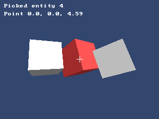

<!-- AUTOGENERATED COPYRIGHT HEADER START -->
<!-- Copyright (C) 2026 Claude <noreply@anthropic.com> -->
<!-- AUTOGENERATED COPYRIGHT HEADER END -->
<!-- Generated by tools/wiki/wiki.py. Edit tools/wiki/text/ instead of this file. -->


# CameraPick

<div align="center">

[Command Index](Command-Index) · [Blitz3D](Blitz3D) · [Picking](Blitz3D-Picking)

</div>


```blitzbasic
CameraPick:Int32 camera:Int32, viewport_x:Float32, viewport_y:Float32
```

| Parameter | Mode | Type | Default | Description |
|---|---|---|---|---|
| `camera` | In | Int32 | required | The camera whose view is used. |
| `viewport_x` | In | Float32 | required | Horizontal pixel position inside the camera's viewport. |
| `viewport_y` | In | Float32 | required | Vertical pixel position inside the camera's viewport. |

**Returns:** The entity found, or 0 if there was none.

## Description

Finds the entity that appears at a pixel of a camera's view, which is how you select things with the mouse. The coordinates are in pixels of the camera's viewport, like [MouseX](MouseX) and [MouseY](MouseY) give them, with 0, 0 at the top left. The ray runs as far as the camera's far range.

Only entities with an [EntityPickMode](EntityPickMode) are found. Afterwards [PickedX](PickedX), [PickedEntity](PickedEntity) and the other Picked commands describe the hit.

## Examples

```blitzbasic
Graphics3D 320, 240, 0, 2
SetBuffer BackBuffer()
camera = CreateCamera()
CameraClsColor camera, 50, 70, 110
light = CreateLight()
RotateEntity light, 40, 30, 0

; Three pickable cubes.
For i = 0 To 2
	cube = CreateCube()
	PositionEntity cube, -2.5 + i * 2.5, 0, 6
	TurnEntity cube, 20, 25 + i * 20, 0
	EntityPickMode cube, 2
	EntityColor cube, 200, 200, 200
Next

; Pick what is under a point and tint it red.
hit = CameraPick(camera, 160, 120)
If hit Then EntityColor hit, 230, 60, 60

RenderWorld
Color 255, 255, 255
Rect 154, 119, 13, 1, 1
Rect 160, 113, 1, 13, 1
If hit
	Text 8, 8, "Picked entity " + hit
	Text 8, 24, "Point " + Int(PickedX() * 100) / 100.0 + ", " + Int(PickedY() * 100) / 100.0 + ", " + Int(PickedZ() * 100) / 100.0
Else
	Text 8, 8, "Nothing picked"
EndIf
Flip
WaitKey
```

## Media



## Related Commands

[EntityPick](EntityPick), [EntityPickMode](EntityPickMode), [LinePick](LinePick)

<div align="center">

[Command Index](Command-Index) · [Blitz3D](Blitz3D) · [Picking](Blitz3D-Picking)

</div>
