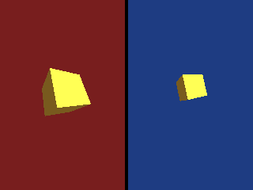

<!-- AUTOGENERATED COPYRIGHT HEADER START -->
<!-- Copyright (C) 2026 Claude <noreply@anthropic.com> -->
<!-- AUTOGENERATED COPYRIGHT HEADER END -->
<!-- Generated by tools/wiki/wiki.py. Edit tools/wiki/text/ instead of this file. -->


# CameraViewport

<div align="center">

[Command Index](Command-Index) · [Blitz3D](Blitz3D) · [Cameras](Blitz3D-Cameras)

</div>


```blitzbasic
CameraViewport camera:Int32, x:Int32, y:Int32, width:Int32, height:Int32
```

| Parameter | Type | Default | Description |
|---|---|---|---|
| `camera` | Int32 | required | Camera handle. |
| `x` | Int32 | required | Left edge of the viewport in the buffer. |
| `y` | Int32 | required | Top edge of the viewport in the buffer. |
| `width` | Int32 | required | Width of the viewport in pixels. |
| `height` | Int32 | required | Height of the viewport in pixels. |

## Description

Restricts the camera to a rectangle of the graphics buffer. Use it for split screen, a rear view mirror or a minimap. The camera keeps its aspect ratio from the size of the rectangle, so a narrow viewport does not squash the picture. Parts of the rectangle outside the buffer are cut off.
The camera clears only its own rectangle, so two cameras with separate viewports can share one frame.

## Examples

```blitzbasic
Graphics3D 320, 240, 0, 2
SetBuffer BackBuffer()
left = CreateCamera()
CameraViewport left, 0, 0, 158, 240
CameraClsColor left, 120, 30, 30
right = CreateCamera()
CameraViewport right, 162, 0, 158, 240
CameraClsColor right, 30, 60, 130
PositionEntity right, 0, 1.5, -2
RotateEntity right, 20, 0, 0
light = CreateLight()
RotateEntity light, 45, 45, 0
cube = CreateCube()
PositionEntity cube, 0, 0, 4
TurnEntity cube, 25, 30, 0
EntityColor cube, 240, 180, 60
RenderWorld
Flip
WaitKey
```

## Media



## Related Commands

[CameraClsColor](CameraClsColor), [CameraClsMode](CameraClsMode), [CameraFogColor](CameraFogColor), [CameraFogMode](CameraFogMode), [CameraFogRange](CameraFogRange), [CameraProject](CameraProject), [CameraProjMode](CameraProjMode), [CameraRange](CameraRange)

<div align="center">

[Command Index](Command-Index) · [Blitz3D](Blitz3D) · [Cameras](Blitz3D-Cameras)

</div>
