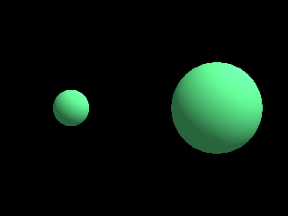

<!-- AUTOGENERATED COPYRIGHT HEADER START -->
<!-- Copyright (C) 2026 Claude <noreply@anthropic.com> -->
<!-- AUTOGENERATED COPYRIGHT HEADER END -->
<!-- Generated by tools/wiki/wiki.py. Edit tools/wiki/text/ instead of this file. -->
# CameraZoom 

<div align="center">

[Command Index](Command-Index) · [Blitz3D](Blitz3D) · [Cameras](Blitz3D-Cameras)

</div>


```blitzbasic
CameraZoom:Void camera:Int32, zoom:Float32
```

| Parameter | Mode | Type | Default | Description |
|---|---|---|---|---|
| `camera` | In | Int32 | required | Camera handle. |
| `zoom` | In | Float32 | required | Magnification, 1 by default. |

## Description

Changes how much the camera magnifies the view. 1 is the default, larger values zoom in and smaller values zoom out. Zoom narrows or widens the field of view, so it can imitate a telescope or a wide angle lens. The runtime does not accept values below 0.001.

## Examples

```blitzbasic
Graphics3D 320, 240, 0, 2
SetBuffer BackBuffer()
normal = CreateCamera()
CameraViewport normal, 0, 0, 158, 240
zoomed = CreateCamera()
CameraViewport zoomed, 162, 0, 158, 240
CameraZoom zoomed, 2.5
light = CreateLight()
RotateEntity light, 45, 45, 0
ball = CreateSphere(16)
PositionEntity ball, 0, 0, 4
EntityColor ball, 80, 200, 120
RenderWorld
Flip
WaitKey
```

## Media



## Related Commands

[CameraClsColor](CameraClsColor) , [CameraClsMode](CameraClsMode) , [CameraCulling](CameraCulling) , [CameraCullingSource](CameraCullingSource) , [CameraFogColor](CameraFogColor) , [CameraFogMode](CameraFogMode) , [CameraFogRange](CameraFogRange) , [CameraProject](CameraProject) 

<div align="center">

[Command Index](Command-Index) · [Blitz3D](Blitz3D) · [Cameras](Blitz3D-Cameras)

</div>
