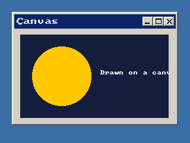

<!-- AUTOGENERATED COPYRIGHT HEADER START -->
<!-- Copyright (C) 2026 Claude <noreply@anthropic.com> -->
<!-- AUTOGENERATED COPYRIGHT HEADER END -->
<!-- Generated by tools/wiki/wiki.py. Edit tools/wiki/text/ instead of this file. -->


# CanvasBuffer

<div align="center">

[Command Index](Command-Index) · [BlitzPlus](BlitzPlus) · [Canvas](BlitzPlus-Canvas)

</div>


```blitzbasic
CanvasBuffer:Int32 canvas:Int32
```

| Parameter | Mode | Type | Default | Description |
|---|---|---|---|---|
| `canvas` | In | Int32 | required | Handle of a canvas made with [CreateCanvas](CreateCanvas). |

**Returns:** A buffer handle that works with `SetBuffer`, `LockBuffer`, `ReadPixel` and the other buffer commands.

## Description

Gives the buffer that a canvas is drawn to. Make it the target with `SetBuffer`, draw with the usual 2D commands like `Rect`, `Line` and `Text`, and then call [FlipCanvas](FlipCanvas) to show the result. The buffer is as big as the canvas.

## Differences

* The buffer has 32 bits of color (RGBA8) whatever depth `Graphics` has, and it is drawn to by the same renderer as the back buffer: `Cls`, the 2D commands, `RenderWorld`, `CopyRect`, `ReadPixel` and `LockBuffer` work in it the same way. When the canvas changes size (`SetGadgetShape`, or its layout following the window) the next `CanvasBuffer` gives a buffer of the new size, with what was drawn before gone, and keeps its handle as long as the size stays. The buffer is as big as the canvas is in the units of the program whatever the display scales the window by, see [CreateWindow](CreateWindow): on a display with a high density of pixels the picture is enlarged when the window is drawn.

## Examples

```blitzbasic
Graphics 320, 240, 32, 2
win = CreateWindow("Canvas", 20, 20, 280, 190, Desktop(), 3)
cv  = CreateCanvas(10, 10, 250, 140, win)
SetBuffer CanvasBuffer(cv)
ClsColor 20, 30, 60
Cls
Color 255, 200, 0
Oval 20, 20, 100, 100, 1
Color 255, 255, 255
Text 135, 60, "Drawn on a canvas"
FlipCanvas cv
Repeat
Until WaitEvent() = $803
```

## Media



## Related Commands

[CreateCanvas](CreateCanvas), [DesktopBuffer](DesktopBuffer), [FlipCanvas](FlipCanvas)

<div align="center">

[Command Index](Command-Index) · [BlitzPlus](BlitzPlus) · [Canvas](BlitzPlus-Canvas)

</div>
