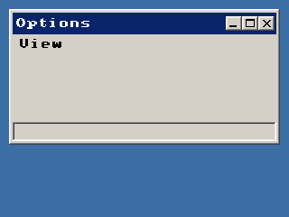

<!-- AUTOGENERATED COPYRIGHT HEADER START -->
<!-- Copyright (C) 2026 Claude <noreply@anthropic.com> -->
<!-- AUTOGENERATED COPYRIGHT HEADER END -->
<!-- Generated by tools/wiki/wiki.py. Edit tools/wiki/text/ instead of this file. -->
# CheckMenu 

<div align="center">

[Command Index](Command-Index) · [BlitzPlus](BlitzPlus) · [Menus](BlitzPlus-Menus)

</div>


```blitzbasic
CheckMenu:Void menu:Int32
```

| Parameter | Mode | Type | Default | Description |
|---|---|---|---|---|
| `menu` | In | Int32 | required | Handle of a menu item made with [CreateMenu](CreateMenu). |

## Description

Puts a check mark in front of a menu item, for options that are on or off. [UncheckMenu](UncheckMenu) takes it away and [MenuChecked](MenuChecked) tells whether it is there. Titles in the menu bar cannot be checked.

## Examples

```blitzbasic
Graphics 320, 240, 32, 2
win  = CreateWindow("Options", 10, 10, 300, 150, Desktop(), 15)
view = CreateMenu("View", 0, WindowMenu(win))
grid = CreateMenu("Show grid", 1, view)
UpdateWindowMenu win
Repeat
	e = WaitEvent()
	If e = $1001 And EventData() = 1 Then
		If MenuChecked(grid) Then UncheckMenu grid Else CheckMenu grid
		UpdateWindowMenu win
	EndIf
Until e = $803
```

## Media



## Related Commands

[CreateMenu](CreateMenu) , [DisableMenu](DisableMenu) , [EnableMenu](EnableMenu) , [MenuChecked](MenuChecked) , [MenuEnabled](MenuEnabled) , [MenuText](MenuText) , [SetMenuText](SetMenuText) , [UncheckMenu](UncheckMenu) 

<div align="center">

[Command Index](Command-Index) · [BlitzPlus](BlitzPlus) · [Menus](BlitzPlus-Menus)

</div>
