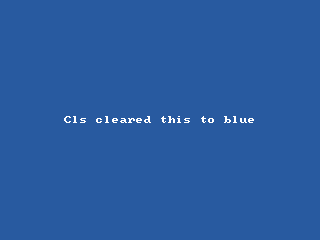

<!-- AUTOGENERATED COPYRIGHT HEADER START -->
<!-- Copyright (C) 2026 Claude <noreply@anthropic.com> -->
<!-- AUTOGENERATED COPYRIGHT HEADER END -->
<!-- Generated by tools/wiki/wiki.py. Edit tools/wiki/text/ instead of this file. -->


# Cls

<div align="center">

[Command Index](Command-Index) · [BlitzBasic](BlitzBasic) · [Drawing](BlitzBasic-Drawing)

</div>


```blitzbasic
Cls:Void
```

## Description

Clears the current buffer with the color set by [ClsColor](ClsColor). Call it at the start of every frame when you redraw the whole picture.

## Examples

```blitzbasic
Graphics 320, 240, 0, 2
SetBuffer BackBuffer()
ClsColor 40, 90, 160
Cls
Color 255, 255, 255
Text 160, 120, "Cls cleared this to blue", 1, 1
Flip
WaitKey
```

## Media



## Related Commands

[ClsColor](ClsColor), [Color](Color)

<div align="center">

[Command Index](Command-Index) · [BlitzBasic](BlitzBasic) · [Drawing](BlitzBasic-Drawing)

</div>
