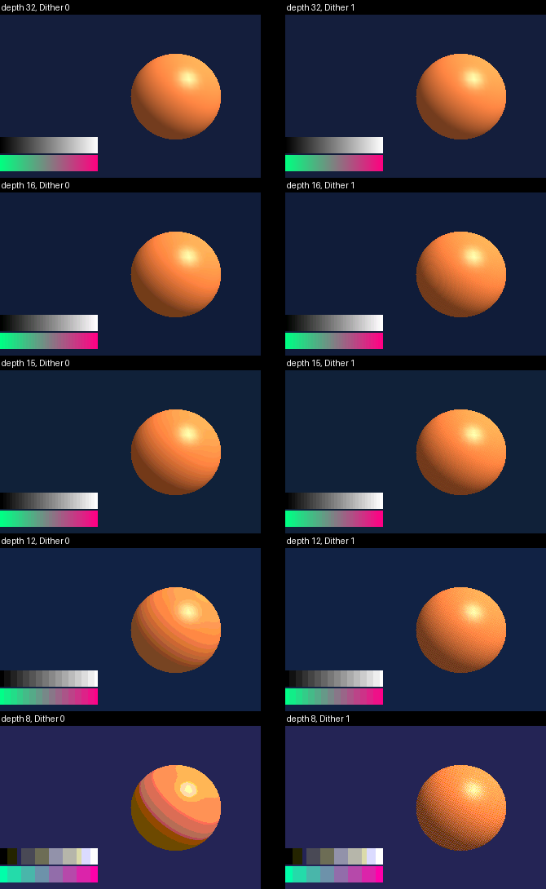
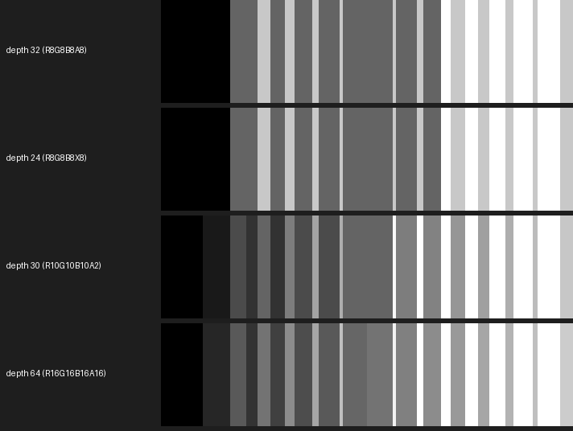
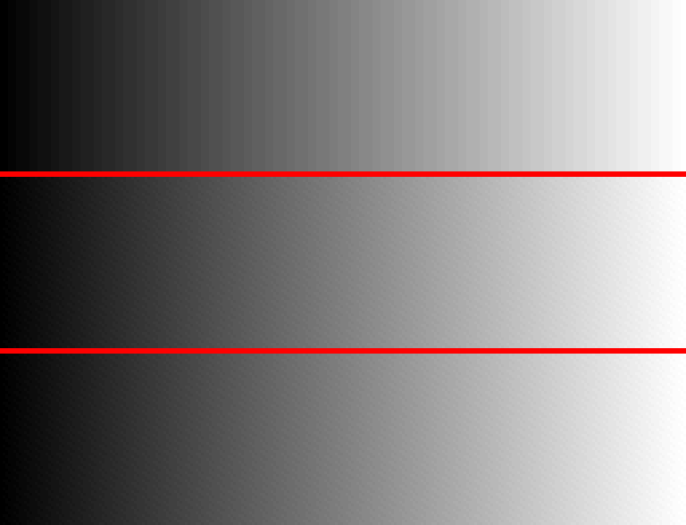

<!-- AUTOGENERATED COPYRIGHT HEADER START -->
<!-- Copyright (C) 2026 Claude <noreply@anthropic.com> -->
<!-- AUTOGENERATED COPYRIGHT HEADER END -->
<!-- Generated by tools/wiki/wiki.py. Edit tools/wiki/text/ instead of this file. -->
# Color depth

The depth argument of `Graphics` and `Graphics3D` decides what the front and back buffer are made of, so that what is drawn on top of each other many times does not lose its small steps to rounding:

| Depth | Format of the buffers |
|---|---|
| 8 | A palette of 256 colors, see below. The buffer is R8G8B8A8 and holds colors of the palette. |
| 12 | R4G4B4A4: 4 bits for each, with alpha. |
| 15 | A1R5G5B5: 5 bits for red, green and blue, and 1 for alpha. |
| 16 | R5G6B5: 5 bits for red and blue and 6 for green. The alpha channel is not used. |
| 24 | R8G8B8X8: 8 bits for red, green and blue. The alpha channel is not used. |
| 30 | R10G10B10A2: 10 bits for red, green and blue, and 2 for alpha. |
| 32 | R8G8B8A8: 8 bits for each, with alpha. |
| 64 | R16G16B16A16: 16 bits for each, with alpha, as half precision floats (1 sign, 5 exponent and 10 mantissa bits), never integers. |

0 (the best there is) gives 32, and so does any other number, with a warning on the console. If the graphics card can't draw to the format that was asked for, the next smaller of the list is used, and a warning says so. Pixels are read and written the way the buffer stores them, with the alpha on top: `ReadPixel`, `WritePixel`, `ReadPixelFast`, `WritePixelFast` and the `CopyPixel`s take and give ARGB for 24 and 32, A2R10G10B10 for 30, and the upper 8 bits of each channel as ARGB for 64. `ReadPixel64`, `WritePixel64`, `ReadPixelFast64` and `WritePixelFast64` work with the channels as `Float16` variables (`ReadPixel64 x, y, buffer, Out red, Out green, Out blue, Out alpha`, `WritePixel64 x, y, buffer, red, green, blue, alpha`) and are never converted to an integer: the depth 64 stores half floats, so what is read is what is stored (values above 1 included) and what is written is stored as it is. The other depths give the value from 0 to 1 that their bits mean, and clamp what is written to 0 to 1. The `Long` that the two read commands return is the memory of the pixel (8 bytes for the depth 64, with the red half float in the lowest 16 bits, then green, blue and alpha; the 4 bytes of the stored word for the others). `LockedPixels` has 4 bytes for each pixel (the number of `ReadPixel`) or 8 for the depth 64 (the half floats as they are in memory), `LockedPitch` fits, and `LockedFormat` says 5 for A2R10G10B10 and 6 for R16G16B16A16. The depths 8, 12, 15 and 16 give and take 8 bits per channel through every one of these commands (`LockedFormat` says 4): the fields are widened by repeating their bits (a 5-bit 31 reads as 255) and writing picks the nearest value the buffer can hold, so what is read is what the buffer holds. Textures and images always stay RGBA8, and `SaveBuffer`, `GrabImage` and `CopyRect` convert on the way. What is shown on the screen is always R8G8B8A8, because HDR is not supported: the wider buffers are converted when they are shown, with the noise of `Dither` if it is on, which hides the bands that the rounding to 8 bits would otherwise make. That conversion is the only place where the buffers of 10 and 16 bits per channel get the noise: 3D drawing into them keeps what the shader makes, as dithering is for the last rounding to 8 bits or less. The buffers of 16, 15 and 12 bits are shown exactly, so the shown picture gets no noise; their 3D drawing gets the noise of `Dither` of one step of 5, 6 or 4 bits instead of 8 before its colors are rounded to the buffer.

## Palette (depth 8)

A `Graphics` or `Graphics3D` with a depth of 8 has 256 colors. The graphics card has no storage with an index per pixel that it could blend and light into, so the buffers stay R8G8B8A8 but hold only colors of the palette: the shaders of 3D drawing light, fog and dither in full color and then make the result into the nearest color of the palette (the smallest distance in red, green and blue). A palette that has every combination of the levels of its channels, like the default one with 8 x 8 x 4, is looked up exactly, per channel, for every value of 8 bits; any other palette uses a lookup texture with the nearest color of every color of 6 bits per channel, which is approximate. With `Dither 2` blended draws read the palette colors that are there and blend them the same way. Draws that blend by the fixed-function blender (no Dither 2) and 2D drawing are made into palette colors when the picture is shown, and `ReadPixel`, `LockBuffer`, `SaveBuffer`, `GrabImage` and the like give palette colors for the front and back buffer.

`GraphicsPalette imagefile$` sets the palette from a picture of 16 by 16 pixels, where the pixel at x,y is the color with the number y * 16 + x (the numbers only matter to the program that made the picture). Without it, or with an empty name, the palette has every color with 3 bits of red, 3 of green and 2 of blue, from 0,0,0 to 255,255,255, in the order of the bits RRRGGGBB. It can be called before or after `Graphics`.

With `Dither` on, the noise is one step of the palette for each channel (the average gap between the values that the palette has for it: 36.4 for red and green and 85 for blue in the default palette), added before the nearest color is picked, so that a gradient is a fine pattern of palette colors that the eye averages out instead of bands. Without it every color is simply the nearest one.

The pictures below are the same scene with the depths 32, 16, 15, 12 and 8, without and with `Dither`.

Below, 100 see-through layers whose alpha grows from column to column are added on top of each other, once for each depth. With 8 bits per channel every layer rounds to 0 or to a whole step, and the ramp has few steps; with 30 and 64 bits the layers add up.

Many faint layers are where the depth matters most: every blend rounds to the buffer's precision, and when the layer's alpha times its distance from the color below is under half a step, the blend changes nothing, so the result stops short of the exact color by up to half a step divided by the alpha (10 steps at an alpha of 0.05) and shows as contour lines in soft mist or smoke made of overlapping sprites. How big the error is depends on the graphics card: in a scene of 50000 sprites, the depth 32 picture of an NVIDIA card is further from the exact result than that of an AMD card, with colored rings at the edge of the mist, probably because its blend units round differently, and its depth 64 blend also comes out slightly brighter in the mist. Depth 30 gave a result within 0.5 steps of the exact one on both cards, so it is the first choice for such scenes. `Dither 1` does not help with this in the depth 32 buffer, as it dithers before the blend rounds again; `Dither 2` turns the contour lines into noise where it is available.

`GraphicsDepth` says what the buffers have. `GfxModeDepth`, `DisplayDepth` and `DisplayModeDepth` always say 32, the mode lists have each size once instead of once per depth the display could show, and `GfxModeExists` and `GfxMode3DExists` do not look at their depth argument. `WBuffer` does nothing, because the depth buffer is the float one described in the depth buffer page.

