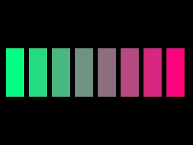

<!-- AUTOGENERATED COPYRIGHT HEADER START -->
<!-- Copyright (C) 2026 Claude <noreply@anthropic.com> -->
<!-- AUTOGENERATED COPYRIGHT HEADER END -->
<!-- Generated by tools/wiki/wiki.py. Edit tools/wiki/text/ instead of this file. -->
# Color 

<div align="center">

[Command Index](Command-Index) · [BlitzBasic](BlitzBasic) · [Drawing](BlitzBasic-Drawing)

</div>


```blitzbasic
Color:Void red:Int32, green:Int32, blue:Int32
```

| Parameter | Mode | Type | Default | Description |
|---|---|---|---|---|
| `red` | In | Int32 | required | Red part, 0 to 255. |
| `green` | In | Int32 | required | Green part, 0 to 255. |
| `blue` | In | Int32 | required | Blue part, 0 to 255. |

## Description

Sets the color that `Plot`, `Line`, `Rect`, `Oval` and `Text` draw with.

## Examples

```blitzbasic
Graphics 320, 240, 0, 2
SetBuffer BackBuffer()
Cls
For i = 0 To 7
	Color i * 36, 255 - i * 36, 128
	Rect 10 + i * 38, 80, 30, 80, 1
Next
Flip
WaitKey
```

## Media



## Related Commands

[ClsColor](ClsColor) , [ColorBlue](ColorBlue) , [ColorGreen](ColorGreen) , [ColorRed](ColorRed) , [GetColor](GetColor) 

<div align="center">

[Command Index](Command-Index) · [BlitzBasic](BlitzBasic) · [Drawing](BlitzBasic-Drawing)

</div>
