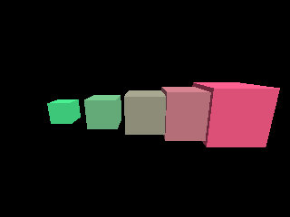

<!-- AUTOGENERATED COPYRIGHT HEADER START -->
<!-- Copyright (C) 2026 Claude <noreply@anthropic.com> -->
<!-- AUTOGENERATED COPYRIGHT HEADER END -->
<!-- Generated by tools/wiki/wiki.py. Edit tools/wiki/text/ instead of this file. -->


# CopyEntity

<div align="center">

[Command Index](Command-Index) · [Blitz3D](Blitz3D) · [Entities](Blitz3D-Entities)

</div>


## Command Syntax

```blitzbasic
CopyEntity:Int32 entity:Int32, parent:Int32=0
```

## Parameters

| Parameter | Type | Default | Description |
|---|---|---|---|
| `entity` | Int32 | required | Entity handle to copy. |
| `parent` | Int32 | `0` | Entity the copy follows, or 0 for none. Defaults to 0. |

**Returns:** The handle of the copy.

## Description

Makes a new entity from an existing one and returns its handle. The copy shares the original's mesh, so changing the mesh itself, for example with `RotateMesh` or by adding vertices, changes every copy. Entity properties such as position, rotation, scale, color and alpha belong to each copy and can be changed apart. Children are copied too. Copying is much cheaper than loading the same file again.

## Differences

* A copy of a hidden entity is visible, where the original gives the copy the hidden state. Show or hide the copy yourself.

## Examples

```blitzbasic
Graphics3D 320, 240, 0, 2
SetBuffer BackBuffer()
camera = CreateCamera()
PositionEntity camera, 0, 2, -7
RotateEntity camera, 15, 0, 0
light = CreateLight()
RotateEntity light, 45, 45, 0
original = CreateCube()
HideEntity original
For i = 0 To 4
	copy = CopyEntity(original)
	PositionEntity copy, i * 2 - 4, 0, 0
	ScaleEntity copy, 0.5 + i * 0.2, 0.5 + i * 0.2, 0.5 + i * 0.2
	EntityColor copy, 60 + i * 40, 200 - i * 30, 120
Next
RenderWorld
Flip
WaitKey
```

## Media



## Related Commands

[FreeEntity](FreeEntity), [HideEntity](HideEntity), [MoveEntity](MoveEntity), [NameEntity](NameEntity), [PaintEntity](PaintEntity), [PointEntity](PointEntity), [PositionEntity](PositionEntity), [RotateEntity](RotateEntity)

<div align="center">

[Command Index](Command-Index) · [Blitz3D](Blitz3D) · [Entities](Blitz3D-Entities)

</div>
