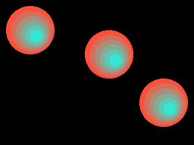

<!-- AUTOGENERATED COPYRIGHT HEADER START -->
<!-- Copyright (C) 2026 Claude <noreply@anthropic.com> -->
<!-- AUTOGENERATED COPYRIGHT HEADER END -->
<!-- Generated by tools/wiki/wiki.py. Edit tools/wiki/text/ instead of this file. -->


# CopyRect

<div align="center">

[Command Index](Command-Index) · [BlitzBasic](BlitzBasic) · [Buffers and Pixels](BlitzBasic-Buffers-and-Pixels)

</div>


## Command Syntax

```blitzbasic
CopyRect source_x:Int32, source_y:Int32, width:Int32, height:Int32, dest_x:Int32, dest_y:Int32, src_buffer:Int32=0, dest_buffer:Int32=0
```

## Parameters

| Parameter | Type | Default | Description |
|---|---|---|---|
| `source_x` | Int32 | required | Left edge of the area to copy. |
| `source_y` | Int32 | required | Top edge of the area to copy. |
| `width` | Int32 | required | Width of the area. |
| `height` | Int32 | required | Height of the area. |
| `dest_x` | Int32 | required | Left edge of the target area. |
| `dest_y` | Int32 | required | Top edge of the target area. |
| `src_buffer` | Int32 | `0` | The buffer to copy from. Defaults to the current buffer. |
| `dest_buffer` | Int32 | `0` | The buffer to copy to. Defaults to the current buffer. |

## Description

Copies a rectangle from one buffer to another, or inside the same buffer, even when the two areas overlap. It is much quicker than copying pixel by pixel, and the way to scroll a picture or to save a part of the screen.

## Differences

* Parts of the rectangle that lie outside of either buffer are cut off.

## Examples

```blitzbasic
Graphics 320, 240, 0, 2
SetBuffer BackBuffer()
Cls
For i = 0 To 5
	Color 255 - i * 40, 80 + i * 30, 60 + i * 30
	Oval 10 + i * 8, 10 + i * 8, 80 - i * 12, 80 - i * 12, 1
Next
CopyRect 0, 0, 100, 100, 130, 40
CopyRect 0, 0, 100, 100, 220, 120
Flip
WaitKey
```

## Media



## Related Commands

[CopyPixel](CopyPixel), [CopyPixelFast](CopyPixelFast), [FrontBuffer](FrontBuffer), [GraphicsBuffer](GraphicsBuffer)

<div align="center">

[Command Index](Command-Index) · [BlitzBasic](BlitzBasic) · [Buffers and Pixels](BlitzBasic-Buffers-and-Pixels)

</div>
