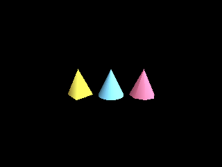

<!-- AUTOGENERATED COPYRIGHT HEADER START -->
<!-- Copyright (C) 2026 Claude <noreply@anthropic.com> -->
<!-- AUTOGENERATED COPYRIGHT HEADER END -->
<!-- Generated by tools/wiki/wiki.py. Edit tools/wiki/text/ instead of this file. -->


# CreateCone

<div align="center">

[Command Index](Command-Index) · [Blitz3D](Blitz3D) · [Meshes](Blitz3D-Meshes)

</div>


```blitzbasic
CreateCone:Int32 segments:Int32=8, solid:Int32=1, parent:Int32=0
```

| Parameter | Mode | Type | Default | Description |
|---|---|---|---|---|
| `segments` | In | Int32 | `8` | Detail of the cone, 3 to 100. Defaults to 8. |
| `solid` | In | Int32 | `1` | 1 for a cone with a base, 0 for an open one. Defaults to 1. |
| `parent` | In | Int32 | `0` | Entity the cone follows, or 0 for none. Defaults to 0. |

**Returns:** The handle of the new cone.

## Description

Creates a cone with a base radius of 1 and its tip pointing up the Y axis. With `solid` set to 0 the base is left open. 4 segments make a pyramid and 16 looks smooth. Valid values are 3 to 100.

## Examples

```blitzbasic
Graphics3D 320, 240, 0, 2
SetBuffer BackBuffer()
camera = CreateCamera()
PositionEntity camera, 0, 2.5, -8
RotateEntity camera, 18, 0, 0
light = CreateLight()
RotateEntity light, 45, 45, 0
pyramid = CreateCone(4)
PositionEntity pyramid, -2.4, 0, 0
EntityColor pyramid, 240, 200, 80
smooth = CreateCone(24)
EntityColor smooth, 120, 200, 240
round = CreateCone(8)
PositionEntity round, 2.4, 0, 0
EntityColor round, 240, 120, 160
RenderWorld
Flip
WaitKey
```

## Media



## Related Commands

[CreateCube](CreateCube), [CreateCylinder](CreateCylinder), [CreateMesh](CreateMesh), [CreateMirror](CreateMirror), [CreatePlane](CreatePlane), [CreateSphere](CreateSphere)

<div align="center">

[Command Index](Command-Index) · [Blitz3D](Blitz3D) · [Meshes](Blitz3D-Meshes)

</div>
