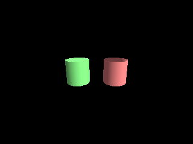

<!-- AUTOGENERATED COPYRIGHT HEADER START -->
<!-- Copyright (C) 2026 Claude <noreply@anthropic.com> -->
<!-- AUTOGENERATED COPYRIGHT HEADER END -->
<!-- Generated by tools/wiki/wiki.py. Edit tools/wiki/text/ instead of this file. -->
# CreateCylinder 

<div align="center">

[Command Index](Command-Index) · [Blitz3D](Blitz3D) · [Meshes](Blitz3D-Meshes)

</div>


```blitzbasic
CreateCylinder:Int32 segments:Int32=8, solid:Int32=1, parent:Int32=0
```

| Parameter | Mode | Type | Default | Description |
|---|---|---|---|---|
| `segments` | In | Int32 | `8` | Detail of the cylinder, 3 or more. Defaults to 8. |
| `solid` | In | Int32 | `1` | 1 for a cylinder with ends, 0 for a tube. Defaults to 1. |
| `parent` | In | Int32 | `0` | Entity the cylinder follows, or 0 for none. Defaults to 0. |

**Returns:** The handle of the new cylinder.

## Description

Creates a cylinder with a radius of 1 that stands along the Y axis from -1 to 1. With `solid` set to 0 the top and bottom are left open and you get a tube. 3 segments make a prism, 8 is about the smallest that still reads as round and 16 looks smooth. Values below 3 count as 3.

## Differences

* The original allows 3 to 100 segments. Here there is no upper limit, but more segments make a bigger mesh that takes longer to build and draw.

## Examples

```blitzbasic
Graphics3D 320, 240, 0, 2
SetBuffer BackBuffer()
camera = CreateCamera()
PositionEntity camera, 0, 2.5, -8
RotateEntity camera, 18, 0, 0
light = CreateLight()
RotateEntity light, 45, 45, 0
closed = CreateCylinder(16)
PositionEntity closed, -1.6, 0, 0
EntityColor closed, 120, 220, 120
tube = CreateCylinder(16, 0)
PositionEntity tube, 1.6, 0, 0
EntityColor tube, 220, 120, 120
EntityFX tube, 16
RenderWorld
Flip
WaitKey
```

## Media



## Related Commands

[CreateCone](CreateCone) , [CreateCube](CreateCube) , [CreateMesh](CreateMesh) , [CreateMirror](CreateMirror) , [CreatePlane](CreatePlane) , [CreateSphere](CreateSphere) 

<div align="center">

[Command Index](Command-Index) · [Blitz3D](Blitz3D) · [Meshes](Blitz3D-Meshes)

</div>
