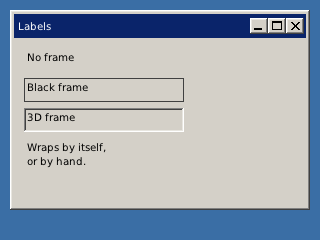

<!-- AUTOGENERATED COPYRIGHT HEADER START -->
<!-- Copyright (C) 2026 Claude <noreply@anthropic.com> -->
<!-- AUTOGENERATED COPYRIGHT HEADER END -->
<!-- Generated by tools/wiki/wiki.py. Edit tools/wiki/text/ instead of this file. -->


# CreateLabel

<div align="center">

[Command Index](Command-Index) · [BlitzPlus](BlitzPlus) · [Gadgets](BlitzPlus-Gadgets)

</div>


## Command Syntax

```blitzbasic
CreateLabel:Int32 text:String, x:Int32, y:Int32, width:Int32, height:Int32, group:Int32, style:Int32=0
```

## Parameters

| Parameter | Type | Default | Description |
|---|---|---|---|
| `text` | String | required | The text to show. |
| `x` | Int32 | required | Horizontal position inside the group. |
| `y` | Int32 | required | Vertical position inside the group. |
| `width` | Int32 | required | Width of the label. |
| `height` | Int32 | required | Height of the label. |
| `group` | Int32 | required | Window, panel, tabber or canvas that holds it. |
| `style` | Int32 | `0` | Frame, see the table. Defaults to 0. |

**Returns:** A handle for the label.

## Description

Makes a piece of text that does not react to the user and sends no events. Long text is wrapped inside the box, and `Chr$(13)` breaks a line by hand. The style adds a frame:

| Style | Frame |
| --- | --- |
| 0 | None |
| 1 | Black line |
| 3 | Sunken 3D frame |

Add 65536 to keep it from following when its group is resized.

## Differences

* Gadgets without a font of their own are drawn with Tahoma at 12 pixels, or a similar font of the system (the built-in bitmap font when there is none). Letters are not as wide as the ones of the Windows interface, so a gadget may need a little more or less room than on Windows.

## Examples

```blitzbasic
Graphics 320, 240, 32, 2
win = CreateWindow("Labels", 10, 10, 300, 200, Desktop(), 3)
CreateLabel "No frame", 10, 10, 160, 24, win, 0
CreateLabel "Black frame", 10, 40, 160, 24, win, 1
CreateLabel "3D frame", 10, 70, 160, 24, win, 3
CreateLabel "Wraps by itself," + Chr$(13) + "or by hand.", 10, 100, 220, 50, win
Repeat
Until WaitEvent() = $803
```

## Media



## Related Commands

[CreateButton](CreateButton), [CreateComboBox](CreateComboBox), [CreateListBox](CreateListBox), [CreatePanel](CreatePanel), [CreateProgBar](CreateProgBar), [CreateSlider](CreateSlider), [CreateTabber](CreateTabber)

<div align="center">

[Command Index](Command-Index) · [BlitzPlus](BlitzPlus) · [Gadgets](BlitzPlus-Gadgets)

</div>
