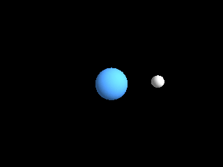

<!-- AUTOGENERATED COPYRIGHT HEADER START -->
<!-- Copyright (C) 2026 Claude <noreply@anthropic.com> -->
<!-- AUTOGENERATED COPYRIGHT HEADER END -->
<!-- Generated by tools/wiki/wiki.py. Edit tools/wiki/text/ instead of this file. -->


# CreatePivot

<div align="center">

[Command Index](Command-Index) · [Blitz3D](Blitz3D) · [Entities](Blitz3D-Entities)

</div>


```blitzbasic
CreatePivot:Int32 parent:Int32=0
```

| Parameter | Mode | Type | Default | Description |
|---|---|---|---|---|
| `parent` | In | Int32 | `0` | Entity the pivot follows, or 0 for none. Defaults to 0. |

**Returns:** The handle of the new pivot.

## Description

Creates an invisible entity that only has a position, rotation and scale. Pivots are the glue of a scene: parent other entities to one and you can move, turn or scale the whole group, or make something orbit by offsetting it from a pivot that you turn. The pivot is created at the origin, even when it has a `parent`.

## Examples

```blitzbasic
Graphics3D 320, 240, 0, 2
SetBuffer BackBuffer()
camera = CreateCamera()
PositionEntity camera, 0, 3.5, -6
RotateEntity camera, 30, 0, 0
light = CreateLight()
RotateEntity light, 45, 45, 0
pivot = CreatePivot()
moon = CreateSphere(12, pivot)
ScaleEntity moon, 0.4, 0.4, 0.4
PositionEntity moon, 3, 0, 0
planet = CreateSphere(16)
EntityColor planet, 80, 160, 255
EntityColor moon, 220, 220, 220
While Not KeyHit(1)
	TurnEntity pivot, 0, 6, 0
	RenderWorld
	Flip
Wend
```

## Media



## Related Commands

[CopyEntity](CopyEntity), [CountChildren](CountChildren), [EntityAlpha](EntityAlpha), [EntityAutoFade](EntityAutoFade)

<div align="center">

[Command Index](Command-Index) · [Blitz3D](Blitz3D) · [Entities](Blitz3D-Entities)

</div>
