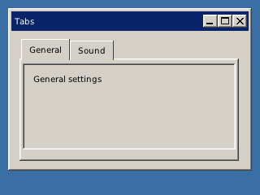

<!-- AUTOGENERATED COPYRIGHT HEADER START -->
<!-- Copyright (C) 2026 Claude <noreply@anthropic.com> -->
<!-- AUTOGENERATED COPYRIGHT HEADER END -->
<!-- Generated by tools/wiki/wiki.py. Edit tools/wiki/text/ instead of this file. -->


# CreateTabber

<div align="center">

[Command Index](Command-Index) · [BlitzPlus](BlitzPlus) · [Gadgets](BlitzPlus-Gadgets)

</div>


```blitzbasic
CreateTabber:Int32 x:Int32, y:Int32, width:Int32, height:Int32, group:Int32, style:Int32=0
```

| Parameter | Type | Default | Description |
|---|---|---|---|
| `x` | Int32 | required | Horizontal position inside the group. |
| `y` | Int32 | required | Vertical position inside the group. |
| `width` | Int32 | required | Width of the tabber. |
| `height` | Int32 | required | Height of the tabber. |
| `group` | Int32 | required | Window, panel or canvas that holds it. |
| `style` | Int32 | `0` | 0, or 65536 to not follow the group when it is resized. Defaults to 0. |

**Returns:** A handle for the tabber.

## Description

Makes a row of tabs. Fill it with [AddGadgetItem](AddGadgetItem), one entry for each tab. The tabber does not hold the contents of the tabs for you: put a panel for each tab in the same window and show only the one that matches the selected tab, when the tabber sends $401.

## Differences

* Gadgets created with the tabber as their group are drawn on it all the time, as in the original. They are not tied to a tab.

## Examples

```blitzbasic
Graphics 320, 240, 32, 2
win = CreateWindow("Tabs", 10, 10, 300, 200, Desktop(), 3)
tabs = CreateTabber(10, 10, 270, 150, win)
AddGadgetItem tabs, "General"
AddGadgetItem tabs, "Sound"
general = CreatePanel(14, 40, 262, 106, win, 1)
CreateLabel "General settings", 10, 10, 200, 20, general
sound = CreatePanel(14, 40, 262, 106, win, 1)
CreateLabel "Sound settings", 10, 10, 200, 20, sound
HideGadget sound
Repeat
	e = WaitEvent()
	If e = $401 And EventSource() = tabs Then
		If SelectedGadgetItem(tabs) = 0 Then ShowGadget general : HideGadget sound
		If SelectedGadgetItem(tabs) = 1 Then ShowGadget sound : HideGadget general
	EndIf
Until e = $803
```

## Media



## Related Commands

[CreateButton](CreateButton), [CreateComboBox](CreateComboBox), [CreateHtmlView](CreateHtmlView) 〔BlitzLLVM〕, [CreateLabel](CreateLabel), [CreateListBox](CreateListBox), [CreatePanel](CreatePanel), [CreateProgBar](CreateProgBar), [CreateSlider](CreateSlider)

<div align="center">

[Command Index](Command-Index) · [BlitzPlus](BlitzPlus) · [Gadgets](BlitzPlus-Gadgets)

</div>
