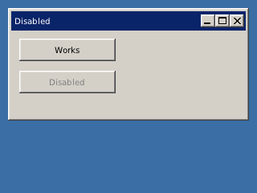

<!-- AUTOGENERATED COPYRIGHT HEADER START -->
<!-- Copyright (C) 2026 Claude <noreply@anthropic.com> -->
<!-- AUTOGENERATED COPYRIGHT HEADER END -->
<!-- Generated by tools/wiki/wiki.py. Edit tools/wiki/text/ instead of this file. -->
# DisableGadget 

<div align="center">

[Command Index](Command-Index) · [BlitzPlus](BlitzPlus) · [Gadgets](BlitzPlus-Gadgets)

</div>


```blitzbasic
DisableGadget:Void gadget:Int32
```

| Parameter | Mode | Type | Default | Description |
|---|---|---|---|---|
| `gadget` | In | Int32 | required | Handle of the gadget. |

## Description

Greys a gadget out so it ignores the user and sends no events. A disabled window disables everything inside it. Combined with a child window this makes a dialog that blocks the window behind it.

## Examples

```blitzbasic
Graphics 320, 240, 32, 2
win = CreateWindow("Disabled", 10, 10, 300, 140, Desktop(), 3)
ok  = CreateButton("Works", 10, 10, 120, 28, win)
no  = CreateButton("Disabled", 10, 50, 120, 28, win)
DisableGadget no
Repeat
Until WaitEvent() = $803
```

## Media



## Related Commands

[ActivateGadget](ActivateGadget) , [AddGadgetItem](AddGadgetItem) , [ClearGadgetItems](ClearGadgetItems) , [CountGadgetItems](CountGadgetItems) , [EnableGadget](EnableGadget) , [FreeGadget](FreeGadget) , [HideGadget](HideGadget) , [ShowGadget](ShowGadget) 

<div align="center">

[Command Index](Command-Index) · [BlitzPlus](BlitzPlus) · [Gadgets](BlitzPlus-Gadgets)

</div>
