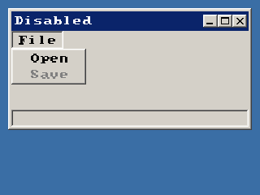

<!-- AUTOGENERATED COPYRIGHT HEADER START -->
<!-- Copyright (C) 2026 Claude <noreply@anthropic.com> -->
<!-- AUTOGENERATED COPYRIGHT HEADER END -->
<!-- Generated by tools/wiki/wiki.py. Edit tools/wiki/text/ instead of this file. -->


# DisableMenu

<div align="center">

[Command Index](Command-Index) · [BlitzPlus](BlitzPlus) · [Menus](BlitzPlus-Menus)

</div>


## Command Syntax

```blitzbasic
DisableMenu menu:Int32
```

## Parameters

| Parameter | Type | Default | Description |
|---|---|---|---|
| `menu` | Int32 | required | Handle of a menu or item. |

## Description

Greys out a menu item so it cannot be chosen and sends no events. [EnableMenu](EnableMenu) brings it back.

## Examples

```blitzbasic
Graphics 320, 240, 32, 2
win  = CreateWindow("Disabled", 10, 10, 300, 150, Desktop(), 15)
file = CreateMenu("File", 0, WindowMenu(win))
CreateMenu "Open", 1, file
save = CreateMenu("Save", 2, file)
DisableMenu save
UpdateWindowMenu win
Repeat
Until WaitEvent() = $803
```

## Media



## Related Commands

[CheckMenu](CheckMenu), [CreateMenu](CreateMenu), [EnableMenu](EnableMenu), [MenuChecked](MenuChecked), [MenuEnabled](MenuEnabled), [MenuText](MenuText), [SetMenuText](SetMenuText), [UncheckMenu](UncheckMenu)

<div align="center">

[Command Index](Command-Index) · [BlitzPlus](BlitzPlus) · [Menus](BlitzPlus-Menus)

</div>
