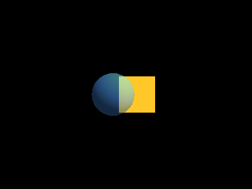

<!-- AUTOGENERATED COPYRIGHT HEADER START -->
<!-- Copyright (C) 2026 Claude <noreply@anthropic.com> -->
<!-- AUTOGENERATED COPYRIGHT HEADER END -->
<!-- Generated by tools/wiki/wiki.py. Edit tools/wiki/text/ instead of this file. -->


# EntityAlpha

<div align="center">

[Command Index](Command-Index) · [Blitz3D](Blitz3D) · [Entities](Blitz3D-Entities)

</div>


## Command Syntax

```blitzbasic
EntityAlpha entity:Int32, alpha:Float32
```

## Parameters

| Parameter | Type | Default | Description |
|---|---|---|---|
| `entity` | Int32 | required | Entity handle. |
| `alpha` | Float32 | required | Opacity from 0 to 1. Defaults to 1 on a new entity. |

## Description

Sets how see-through an entity is: 1 is solid, 0 is invisible and values in between let what is behind show through. An entity with alpha 0 is not drawn at all but still takes part in collisions, unlike [HideEntity](HideEntity). See-through entities are drawn after the solid ones.

## Examples

```blitzbasic
Graphics3D 320, 240, 0, 2
SetBuffer BackBuffer()
camera = CreateCamera()
PositionEntity camera, 0, 0, -6
light = CreateLight()
RotateEntity light, 45, 45, 0
back = CreateCube()
PositionEntity back, 0.6, 0, 2
EntityColor back, 255, 200, 40
glass = CreateSphere(20)
PositionEntity glass, -0.6, 0, 0
EntityColor glass, 80, 160, 255
EntityAlpha glass, 0.5
RenderWorld
Flip
WaitKey
```

## Media



## Related Commands

[EntityAutoFade](EntityAutoFade), [EntityBlend](EntityBlend), [EntityClass](EntityClass), [EntityColor](EntityColor), [EntityDistance](EntityDistance), [EntityFX](EntityFX), [EntityInView](EntityInView), [EntityName](EntityName)

<div align="center">

[Command Index](Command-Index) · [Blitz3D](Blitz3D) · [Entities](Blitz3D-Entities)

</div>
