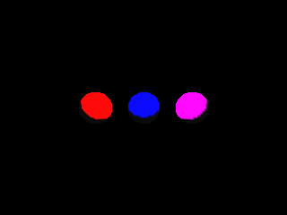
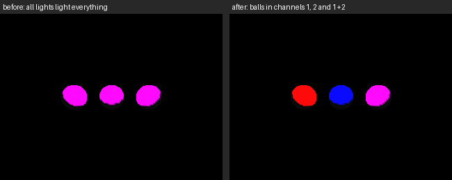

<!-- AUTOGENERATED COPYRIGHT HEADER START -->
<!-- Copyright (C) 2026 Claude <noreply@anthropic.com> -->
<!-- AUTOGENERATED COPYRIGHT HEADER END -->
<!-- Generated by tools/wiki/wiki.py. Edit tools/wiki/text/ instead of this file. -->


# EntityLightChannel 〔BlitzLLVM〕

<div align="center">

[Command Index](Command-Index) · [Blitz3D](Blitz3D) · [Entities](Blitz3D-Entities)

</div>


```blitzbasic
EntityLightChannel:Void entity:Int32, channel:Int32
```

| Parameter | Mode | Type | Default | Description |
|---|---|---|---|---|
| `entity` | In | Int32 | required | Entity handle, of an entity or of a light. |
| `channel` | In | Int32 | required | The channels as bits (0 to 255): bit 0 is channel 1 up to bit 7 for channel 8. |

## Description

**〔BlitzLLVM〕** This command does not exist in the original Blitz products. BlitzLLVM adds it.

Sets the light channels of an entity. A channel is one bit of `channel`, so there are 8 of them (1, 2, 4, 8, 16, 32, 64 and 128) and the values add up: 3 is channel 1 and 2. The default is 255, all channels, so entities that never use channels behave as before.

Lights are entities too, so this sets the channels a light shines into. An entity is only lit by the lights that share at least one channel with it, and 0 means no light reaches it (and a light with 0 lights nothing). Meshes, sprites and terrains all use it, and the channel of an entity is not passed on to its children.

[AmbientLight](AmbientLight) is not a light of any channel: it lights every entity, and an entity with [EntityFX](EntityFX) 1 ignores lights anyway.

Which lights count is decided per entity: only the lights that share a channel with it are considered, and the 8 of them that matter the most to it light it (see [Many-Lights](Many-Lights)). Lights of other channels never use up one of the 8.

## Examples

```blitzbasic
Graphics3D 320, 240, 0, 2
SetBuffer BackBuffer()
camera = CreateCamera()
PositionEntity camera, 0, 0, -9
AmbientLight 10, 10, 10
; A red light for channel 1 and a blue light for channel 2.
red = CreateLight(2)
PositionEntity red, 0, 3, -3
LightColor red, 255, 0, 0
EntityLightChannel red, 1
blue = CreateLight(2)
PositionEntity blue, 0, 3, -3
LightColor blue, 0, 0, 255
EntityLightChannel blue, 2
; The left ball is in channel 1, the middle one in channel 2 and the right one in both.
For i = 0 To 2
	ball = CreateSphere(24)
	PositionEntity ball, i * 3 - 3, 0, 0
	EntityLightChannel ball, i + 1
Next
RenderWorld
Flip
WaitKey
```


Without channels all three balls are lit by both lights and look the same (left), with them each ball only gets the light of its channels (right):


This is a BlitzLLVM extension: the originals have no light channels.

## Media





## Related Commands

[EntityAlpha](EntityAlpha), [EntityAutoFade](EntityAutoFade), [EntityBlend](EntityBlend), [EntityClass](EntityClass), [EntityColor](EntityColor), [EntityDepthFade](EntityDepthFade) 〔BlitzLLVM〕, [EntityDistance](EntityDistance), [EntityFX](EntityFX)

<div align="center">

[Command Index](Command-Index) · [Blitz3D](Blitz3D) · [Entities](Blitz3D-Entities)

</div>
