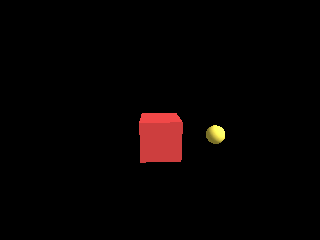

<!-- AUTOGENERATED COPYRIGHT HEADER START -->
<!-- Copyright (C) 2026 Claude <noreply@anthropic.com> -->
<!-- AUTOGENERATED COPYRIGHT HEADER END -->
<!-- Generated by tools/wiki/wiki.py. Edit tools/wiki/text/ instead of this file. -->


# EntityParent

<div align="center">

[Command Index](Command-Index) · [Blitz3D](Blitz3D) · [Entities](Blitz3D-Entities)

</div>


```blitzbasic
EntityParent:Void entity:Int32, parent:Int32, global:Int32=1
```

| Parameter | Mode | Type | Default | Description |
|---|---|---|---|---|
| `entity` | In | Int32 | required | Entity handle. |
| `parent` | In | Int32 | required | Handle of the new parent, 0 for none. |
| `global` | In | Int32 | `1` | 1 to keep the world position and angle, 0 to keep the local values. Defaults to 1. |

## Description

Attaches an entity to a parent, or detaches it with a parent of 0. The child then follows the parent's position, rotation and scale, but moving the child never moves the parent. With `global` set to 1 (the default) the child stays where it is in the world and its local values are changed to match. With 0 its local values stay and it jumps to wherever they now lead.
An entity cannot be attached to one of its own children.

## Examples

```blitzbasic
Graphics3D 320, 240, 0, 2
SetBuffer BackBuffer()
camera = CreateCamera()
PositionEntity camera, 0, 3, -8
RotateEntity camera, 15, 0, 0
light = CreateLight()
RotateEntity light, 45, 45, 0
body = CreateCube()
EntityColor body, 200, 60, 60
; The child keeps its own position, 3 units to the right of the parent, with a global of 0.
arm = CreateSphere(12)
ScaleEntity arm, 0.5, 0.5, 0.5
EntityColor arm, 240, 220, 80
EntityParent arm, body, 0
PositionEntity arm, 3, 0, 0
While Not KeyHit(1)
	; Turning the parent carries the child around, turning the child does not turn the parent.
	TurnEntity body, 0, 3, 0
	TurnEntity arm, 5, 0, 0
	RenderWorld
	Flip
Wend
```

## Media



## Related Commands

[EntityAlpha](EntityAlpha), [EntityAutoFade](EntityAutoFade), [EntityBlend](EntityBlend), [EntityClass](EntityClass), [EntityColor](EntityColor), [EntityDepthFade](EntityDepthFade) 〔BlitzLLVM〕, [EntityDistance](EntityDistance), [EntityFX](EntityFX)

<div align="center">

[Command Index](Command-Index) · [Blitz3D](Blitz3D) · [Entities](Blitz3D-Entities)

</div>
