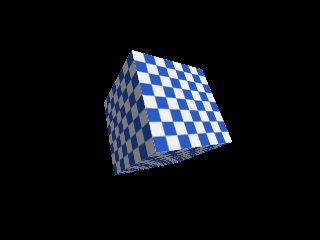

<!-- AUTOGENERATED COPYRIGHT HEADER START -->
<!-- Copyright (C) 2026 Claude <noreply@anthropic.com> -->
<!-- AUTOGENERATED COPYRIGHT HEADER END -->
<!-- Generated by tools/wiki/wiki.py. Edit tools/wiki/text/ instead of this file. -->


# EntityTexture

<div align="center">

[Command Index](Command-Index) · [Blitz3D](Blitz3D) · [Entities](Blitz3D-Entities)

</div>


```blitzbasic
EntityTexture:Void entity:Int32, texture:Int32, frame:Int32=0, index:Int32=0
```

| Parameter | Mode | Type | Default | Description |
|---|---|---|---|---|
| `entity` | In | Int32 | required | Entity handle. |
| `texture` | In | Int32 | required | Texture handle. |
| `frame` | In | Int32 | `0` | Frame of an animated texture. Defaults to 0. |
| `index` | In | Int32 | `0` | Texture layer, 0 to 7. Defaults to 0. |

## Description

Puts a texture on the whole entity, replacing the one of its mesh. `frame` picks the frame of an animated texture and `index` picks the layer for multitexturing, 0 to 7, see `TextureBlend`. Textures made with [CreateTexture](CreateTexture) or [LoadTexture](LoadTexture) can be shared between any number of entities.

## Differences

* A debug build (`-d`) stops the program when the texture is not 0 and does not exist, see [Debug handle checks](Debug-Handle-Checks).

## Examples

```blitzbasic
Graphics3D 320, 240, 0, 2
SetBuffer BackBuffer()
camera = CreateCamera()
PositionEntity camera, 0, 0, -4
light = CreateLight()
RotateEntity light, 45, 45, 0
tex = CreateTexture(64, 64, 1 + 4096)
SetBuffer TextureBuffer(tex)
For y = 0 To 7
	For x = 0 To 7
		If (x + y) Mod 2 = 0 Then Color 240, 240, 240 Else Color 40, 90, 200
		Rect x * 8, y * 8, 8, 8, 1
	Next
Next
SetBuffer BackBuffer()
cube = CreateCube()
TurnEntity cube, 25, 35, 0
EntityTexture cube, tex
RenderWorld
Flip
WaitKey
```

## Media



## Related Commands

[EntityAlpha](EntityAlpha), [EntityAutoFade](EntityAutoFade), [EntityBlend](EntityBlend), [EntityClass](EntityClass), [EntityColor](EntityColor), [EntityDepthFade](EntityDepthFade) 〔BlitzLLVM〕, [EntityDistance](EntityDistance), [EntityFX](EntityFX)

<div align="center">

[Command Index](Command-Index) · [Blitz3D](Blitz3D) · [Entities](Blitz3D-Entities)

</div>
