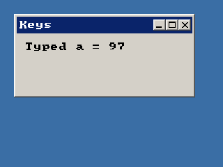

<!-- AUTOGENERATED COPYRIGHT HEADER START -->
<!-- Copyright (C) 2026 Claude <noreply@anthropic.com> -->
<!-- AUTOGENERATED COPYRIGHT HEADER END -->
<!-- Generated by tools/wiki/wiki.py. Edit tools/wiki/text/ instead of this file. -->


# EventData

<div align="center">

[Command Index](Command-Index) · [BlitzPlus](BlitzPlus) · [Events](BlitzPlus-Events)

</div>


```blitzbasic
EventData:Int32
```

**Returns:** The data of the event, see the table. Keeps its value until the next call of `WaitEvent`.

## Description

Gives the extra number of the event that [WaitEvent](WaitEvent) took last. What it means depends on the kind of event:

| Event | ID | Data | Source | X / Y / Z |
| --- | --- | --- | --- | --- |
| KeyDown | $101 | Scan code | - | - |
| KeyUp | $102 | Scan code | - | - |
| KeyStroke | $103 | ASCII code | - | - |
| MouseDown | $201 | Mouse button | Gadget | - |
| MouseUp | $202 | Mouse button | Gadget | - |
| MouseMove | $203 | - | Canvas | Mouse position |
| MouseWheel | $204 | Turns | - | - |
| MouseEnter | $205 | - | Canvas | Mouse position |
| MouseLeave | $206 | - | Canvas | - |
| GadgetAction | $401 | New value | Gadget | - |
| WindowMove | $801 | - | Window | New position |
| WindowSize | $802 | - | Window | New size |
| WindowClose | $803 | - | Window | - |
| WindowActivate | $804 | - | Window | - |
| MenuEvent | $1001 | Menu number | - | - |
| AppSuspend | $2001 | - | - | - |
| AppResume | $2002 | - | - | - |
| AppBeginModal | $2004 | - | - | - |
| AppEndModal | $2005 | - | - | - |
| TimerTick | $4001 | Ticks so far | Timer | - |

## Examples

```blitzbasic
Graphics 320, 240, 32, 2
win  = CreateWindow("Keys", 20, 20, 260, 120, Desktop(), 3)
info = CreateLabel("Press a key", 10, 10, 230, 60, win)
Repeat
	e = WaitEvent()
	If e = $103 Then SetGadgetText info, "Typed " + Chr$(EventData()) + " = " + EventData()
Until e = $803
```

## Media



## Related Commands

[EventID](EventID), [EventSource](EventSource), [EventX](EventX), [EventY](EventY), [EventZ](EventZ), [PeekEvent](PeekEvent), [WaitEvent](WaitEvent)

<div align="center">

[Command Index](Command-Index) · [BlitzPlus](BlitzPlus) · [Events](BlitzPlus-Events)

</div>
