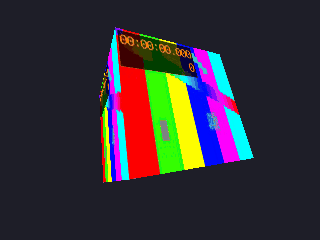

<!-- AUTOGENERATED COPYRIGHT HEADER START -->
<!-- Copyright (C) 2026 Claude <noreply@anthropic.com> -->
<!-- AUTOGENERATED COPYRIGHT HEADER END -->
<!-- Generated by tools/wiki/wiki.py. Edit tools/wiki/text/ instead of this file. -->


# GetMovieTexture 〔BlitzLLVM〕

<div align="center">

[Command Index](Command-Index) · [BlitzBasic](BlitzBasic) · [Movies](BlitzBasic-Movies)

</div>


```blitzbasic
GetMovieTexture:Int32 movie:Int32
```

| Parameter | Type | Default | Description |
|---|---|---|---|
| `movie` | Int32 | required | A movie handle from [OpenMovie](OpenMovie). |

**Returns:** The handle of the texture, or 0 if the movie is not open.

## Description

**〔BlitzLLVM〕** This command does not exist in the original Blitz products. BlitzLLVM adds it.

Gives a texture that shows the movie, so that a movie can be on any surface of a 3D scene: a cube, a screen in a room, a sprite. The texture is as big as the movie and always has the picture of the movie that is playing. It is brought up to date whenever the program draws a movie ([DrawMovie](DrawMovie)), asks about one ([MoviePlaying](MoviePlaying), [MoviePosition](MoviePosition)), renders the world ([RenderWorld](RenderWorld)) or waits ([Delay](Delay)), so a 3D program only needs to render. Asking for the texture starts a movie that was not started yet, and the texture follows all the movie commands: it stays on the picture while the movie is paused, shows the first picture after [StopMovie](StopMovie) and the picture of the position after [SeekMovie](SeekMovie). This is a BlitzLLVM extension: the originals can only draw a movie onto the screen.

Every call for the same movie gives the same texture. It belongs to the movie, so do not free it with [FreeTexture](FreeTexture): it is freed with [CloseMovie](CloseMovie). It is an ordinary color texture without mip maps, which can be given to an entity with [EntityTexture](EntityTexture), a brush with [BrushTexture](BrushTexture) and so on, and whose sampler can be changed with [SetTextureSampler](SetTextureSampler).

## Differences

* A debug build (`-d`) stops the program when the movie does not exist, for example the 0 of a movie that failed to open, other builds ignore the command, see [Debug handle checks](Debug-Handle-Checks).

## Examples

```blitzbasic
Graphics3D 640, 480, 0, 2
SetBuffer BackBuffer()
camera = CreateCamera()
PositionEntity camera, 0, 0, -3
cube = CreateCube()
EntityFX cube, 1                 ; not lit, so the movie has its own colors
movie = OpenMovie("intro.mpg")
EntityTexture cube, GetMovieTexture(movie)
While Not KeyHit(1)
	TurnEntity cube, 0, 1, 0
	RenderWorld
	Flip
Wend
```
A movie of a test pattern on a turning cube (the program above, made with `tools/render_movie_samples.py`); the picture is the one of the movie at that time:

## Media



## Related Commands

[CloseMovie](CloseMovie), [DrawMovie](DrawMovie), [LoopMovie](LoopMovie) 〔BlitzLLVM〕, [MovieHeight](MovieHeight), [MovieLength](MovieLength) 〔BlitzLLVM〕, [MoviePlaying](MoviePlaying), [MoviePosition](MoviePosition) 〔BlitzLLVM〕, [MovieVolume](MovieVolume) 〔BlitzLLVM〕

<div align="center">

[Command Index](Command-Index) · [BlitzBasic](BlitzBasic) · [Movies](BlitzBasic-Movies)

</div>
