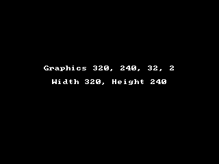

<!-- AUTOGENERATED COPYRIGHT HEADER START -->
<!-- Copyright (C) 2026 Claude <noreply@anthropic.com> -->
<!-- AUTOGENERATED COPYRIGHT HEADER END -->
<!-- Generated by tools/wiki/wiki.py. Edit tools/wiki/text/ instead of this file. -->


# Graphics

<div align="center">

[Command Index](Command-Index) · [BlitzBasic](BlitzBasic) · [Display](BlitzBasic-Display)

</div>


```blitzbasic
Graphics width:Int32, height:Int32, depth:Int32=0, mode:Int32=0
```

| Parameter | Type | Default | Description |
|---|---|---|---|
| `width` | Int32 | required | Width of the picture in pixels. |
| `height` | Int32 | required | Height of the picture in pixels. |
| `depth` | Int32 | `0` | Color depth in bits: 24, 30, 32 or 64, which pick the format of the buffers, or 0 for 32. Defaults to 0. |
| `mode` | Int32 | `0` | 0 opens a window, 1 uses full screen (a borderless window over the display, see [Fullscreen](Fullscreen)), 2 opens a window and 3 opens a window that the user can resize. 4 opens a window without a border: no title bar and no frame. Mode 4 is a BlitzLLVM extension that original Blitz does not have. Defaults to 0. |

## Description

Opens the graphics window and has to be called before any drawing command. Calling it again closes the window and opens a new one, and then all images and textures are gone, so load them again. It also puts the colors and the current buffer back to their defaults.

## Differences

* The color depth picks the format of the buffers: 24 is R8G8B8X8, 30 is R10G10B10A2, 32 is R8G8B8A8 and 64 is R16G16B16A16. 0 and 16 give 32, as does any other number, because palette and 16 bit rendering are not supported. See [Color depth](Color-Depth).
* Full screen (mode 1) does not change the video mode of the display: the picture is shown at the largest size that fits with its aspect ratio kept, and the rest is black. See [Fullscreen](Fullscreen).
* In a resizable window (mode 3) the picture is scaled to the size of the window, and the mouse position is converted to picture pixels.
* The modes 6 and 7 of Blitz3D, which pause the program while the window is in the background, act like 2 and 3. The program keeps running.
* A window without a border (mode 4) has the size you ask for and cannot be resized by the user.
* A width or height below 1 stops the program with an error message.

## Examples

```blitzbasic
Graphics 320, 240, 32, 2
SetBuffer BackBuffer()
Cls
Text 160, 100, "Graphics 320, 240, 32, 2", 1, 1
Text 160, 120, "Width " + GraphicsWidth() + ", Height " + GraphicsHeight(), 1, 1
Flip
WaitKey
```

## Media



## Related Commands

[EndGraphics](EndGraphics), [GraphicsDepth](GraphicsDepth), [GraphicsFormat](GraphicsFormat), [GraphicsHeight](GraphicsHeight), [GraphicsLost](GraphicsLost), [GraphicsWidth](GraphicsWidth)

<div align="center">

[Command Index](Command-Index) · [BlitzBasic](BlitzBasic) · [Display](BlitzBasic-Display)

</div>
