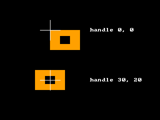

<!-- AUTOGENERATED COPYRIGHT HEADER START -->
<!-- Copyright (C) 2026 Claude <noreply@anthropic.com> -->
<!-- AUTOGENERATED COPYRIGHT HEADER END -->
<!-- Generated by tools/wiki/wiki.py. Edit tools/wiki/text/ instead of this file. -->
# HandleImage   

<div align="center">

[Command Index](Command-Index) · [BlitzBasic](BlitzBasic) · [Images](BlitzBasic-Images)

</div>


```blitzbasic
HandleImage:Void image:Int32, x:Int32, y:Int32
```

| Parameter | Mode | Type | Default | Description |
|---|---|---|---|---|
| `image` | In | Int32 | required | The image. |
| `x` | In | Int32 | required | Horizontal position of the handle, counted from the left edge. |
| `y` | In | Int32 | required | Vertical position of the handle, counted from the top edge. |

## Description

Sets the handle of an image: the point of the image that is placed at the position given to [DrawImage](DrawImage). The handle is measured from the top left corner of the image, and it is also the point around which [RotateImage](RotateImage) and [ScaleImage](ScaleImage) work. It may lie outside of the image.

## Examples

```blitzbasic
Graphics 320, 240, 0, 2
SetBuffer BackBuffer()
Local img = CreateImage(60, 40)
SetBuffer ImageBuffer(img)
Color 255, 160, 0
Rect 0, 0, 60, 40, 1
Color 0, 0, 0
Rect 20, 12, 20, 16, 1
SetBuffer BackBuffer()
Cls
HandleImage img, 0, 0
DrawImage img, 100, 60
HandleImage img, 30, 20
DrawImage img, 100, 160
Color 255, 255, 255
Line 80, 60, 120, 60 : Line 100, 40, 100, 80
Line 80, 160, 120, 160 : Line 100, 140, 100, 180
Text 180, 60, "handle 0, 0", 0, 1
Text 180, 160, "handle 30, 20", 0, 1
Flip
WaitKey
```

## Media



## Related Commands

[CopyImage](CopyImage)   , [CreateImage](CreateImage)   , [DrawImage](DrawImage)   , [FreeImage](FreeImage)   , [GrabImage](GrabImage)   , [LoadAnimImage](LoadAnimImage)   , [LoadImage](LoadImage)   , [MaskImage](MaskImage)   

<div align="center">

[Command Index](Command-Index) · [BlitzBasic](BlitzBasic) · [Images](BlitzBasic-Images)

</div>
