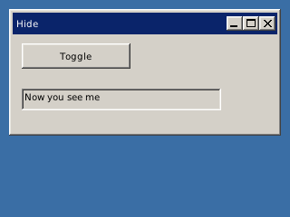

<!-- AUTOGENERATED COPYRIGHT HEADER START -->
<!-- Copyright (C) 2026 Claude <noreply@anthropic.com> -->
<!-- AUTOGENERATED COPYRIGHT HEADER END -->
<!-- Generated by tools/wiki/wiki.py. Edit tools/wiki/text/ instead of this file. -->
# HideGadget 

<div align="center">

[Command Index](Command-Index) · [BlitzPlus](BlitzPlus) · [Gadgets](BlitzPlus-Gadgets)

</div>


```blitzbasic
HideGadget:Void gadget:Int32
```

| Parameter | Mode | Type | Default | Description |
|---|---|---|---|---|
| `gadget` | In | Int32 | required | Handle of the gadget. |

## Description

Makes a gadget invisible, with everything inside it. It also cannot be used. [ShowGadget](ShowGadget) brings it back. It is quicker than freeing and making it again.

## Examples

```blitzbasic
Graphics 320, 240, 32, 2
win    = CreateWindow("Hide", 10, 10, 300, 140, Desktop(), 3)
toggle = CreateButton("Toggle", 10, 10, 120, 28, win)
lab    = CreateLabel("Now you see me", 10, 60, 220, 24, win, 3)
shown  = True
Repeat
	e = WaitEvent()
	If e = $401 And EventSource() = toggle Then
		shown = Not shown
		If shown Then ShowGadget lab Else HideGadget lab
	EndIf
Until e = $803
```

## Media



## Related Commands

[ActivateGadget](ActivateGadget) , [AddGadgetItem](AddGadgetItem) , [ClearGadgetItems](ClearGadgetItems) , [CountGadgetItems](CountGadgetItems) , [DisableGadget](DisableGadget) , [EnableGadget](EnableGadget) , [FreeGadget](FreeGadget) , [ShowGadget](ShowGadget) 

<div align="center">

[Command Index](Command-Index) · [BlitzPlus](BlitzPlus) · [Gadgets](BlitzPlus-Gadgets)

</div>
