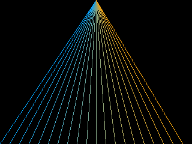

<!-- AUTOGENERATED COPYRIGHT HEADER START -->
<!-- Copyright (C) 2026 Claude <noreply@anthropic.com> -->
<!-- AUTOGENERATED COPYRIGHT HEADER END -->
<!-- Generated by tools/wiki/wiki.py. Edit tools/wiki/text/ instead of this file. -->


# Line

<div align="center">

[Command Index](Command-Index) · [BlitzBasic](BlitzBasic) · [Drawing](BlitzBasic-Drawing)

</div>


```blitzbasic
Line:Void x1:Int32, y1:Int32, x2:Int32, y2:Int32
```

| Parameter | Mode | Type | Default | Description |
|---|---|---|---|---|
| `x1` | In | Int32 | required | Horizontal position of the start. |
| `y1` | In | Int32 | required | Vertical position of the start. |
| `x2` | In | Int32 | required | Horizontal position of the end. |
| `y2` | In | Int32 | required | Vertical position of the end. |

## Description

Draws a line between two points. Both end points are drawn, and the line is made of whole pixels like in the original.

## Examples

```blitzbasic
Graphics 320, 240, 0, 2
SetBuffer BackBuffer()
Cls
For i = 0 To 319 Step 16
	Color i * 255 / 319, 160, 255 - i * 255 / 319
	Line 160, 0, i, 239
Next
Flip
WaitKey
```

## Media



## Related Commands

[ColorRed](ColorRed), [GetColor](GetColor), [Origin](Origin), [ScanLine](ScanLine)

<div align="center">

[Command Index](Command-Index) · [BlitzBasic](BlitzBasic) · [Drawing](BlitzBasic-Drawing)

</div>
