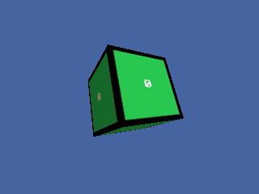

<!-- AUTOGENERATED COPYRIGHT HEADER START -->
<!-- Copyright (C) 2026 Claude <noreply@anthropic.com> -->
<!-- AUTOGENERATED COPYRIGHT HEADER END -->
<!-- Generated by tools/wiki/wiki.py. Edit tools/wiki/text/ instead of this file. -->


# LoadAnimTexture

<div align="center">

[Command Index](Command-Index) · [Blitz3D](Blitz3D) · [Textures](Blitz3D-Textures)

</div>


## Command Syntax

```blitzbasic
LoadAnimTexture:Int32 file:String, flags:Int32, width:Int32, height:Int32, first:Int32, count:Int32
```

## Parameters

| Parameter | Type | Default | Description |
|---|---|---|---|
| `file` | String | required | Picture file that contains all frames. |
| `flags` | Int32 | required | Texture flags, see CreateTexture. |
| `width` | Int32 | required |  |
| `height` | Int32 | required |  |
| `first` | Int32 | required |  |
| `count` | Int32 | required |  |

**Returns:** A texture handle, or 0 if the file could not be loaded.

## Description

Loads one picture that holds several frames laid out left to right, top to bottom, and returns a texture that can show any of them. Choose the frame to show with the frame argument of [EntityTexture](EntityTexture), [BrushTexture](BrushTexture) or [TextureBuffer](TextureBuffer). The flags are the same as for [CreateTexture](CreateTexture).

`first_frame` is the cell that counts as frame 0, and `frame_count` is how many cells are used from there. A sheet 256 pixels wide with 64 pixel frames has four cells per row, so cell 5 is the second cell of the second row.

## Differences

* TextureWidth and TextureHeight report the size of one frame, not of the whole sheet.

## Examples

```blitzbasic
Graphics3D 320, 240, 0, 2
SetBuffer BackBuffer()
camera = CreateCamera()
CameraClsColor camera, 70, 100, 160
light = CreateLight()
RotateEntity light, 40, 30, 0
cube = CreateCube()
PositionEntity cube, 0, 0, 4.2
TurnEntity cube, 20, 30, 0

; Draw a sheet of 4 frames, 64 pixels each, and keep it in a file.
sheet = CreateTexture(256, 64)
SetBuffer TextureBuffer(sheet)
ClsColor 0, 0, 0
Cls
For f = 0 To 3
	Color 40 + f * 60, 200 - f * 40, 80
	Rect f * 64 + 4, 4, 56, 56, 1
	Color 255, 255, 255
	Text f * 64 + 32, 32, Str(f), 1, 1
Next
SaveBuffer TextureBuffer(sheet), "wiki_sheet.bmp"
SetBuffer BackBuffer()
FreeTexture sheet

anim = LoadAnimTexture("wiki_sheet.bmp", 1, 64, 64, 0, 4)
For i = 0 To 39
	EntityTexture cube, anim, (i / 10) Mod 4
	TurnEntity cube, 0, 2, 0
	RenderWorld
	Flip
Next
```

## Media



## Related Commands

[ClearTextureFilters](ClearTextureFilters), [CreateTexture](CreateTexture), [FreeTexture](FreeTexture), [LoadTexture](LoadTexture), [PositionTexture](PositionTexture), [RotateTexture](RotateTexture), [ScaleTexture](ScaleTexture), [SetTextureSampler](SetTextureSampler) 〔BlitzLLVM〕

<div align="center">

[Command Index](Command-Index) · [Blitz3D](Blitz3D) · [Textures](Blitz3D-Textures)

</div>
