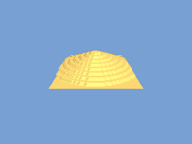

<!-- AUTOGENERATED COPYRIGHT HEADER START -->
<!-- Copyright (C) 2026 Claude <noreply@anthropic.com> -->
<!-- AUTOGENERATED COPYRIGHT HEADER END -->
<!-- Generated by tools/wiki/wiki.py. Edit tools/wiki/text/ instead of this file. -->


# LoadTerrain

<div align="center">

[Command Index](Command-Index) · [Blitz3D](Blitz3D) · [Terrain](Blitz3D-Terrain)

</div>


```blitzbasic
LoadTerrain:Int32 heightmap_file:String, parent:Int32=0
```

| Parameter | Mode | Type | Default | Description |
|---|---|---|---|---|
| `heightmap_file` | In | String | required |  |
| `parent` | In | Int32 | `0` | Optional parent entity. |

**Returns:** An entity handle for the terrain.

## Description

Creates a terrain from a picture. Each pixel of the picture becomes one height point: the brightest of its red, green and blue values is divided by 255, so a white pixel is the full height of 1 and black is 0. The grid size is the width of the picture, the top row of the picture becomes the far edge of the terrain, and the picture has to be square with a power of two size, for example 64 by 64, or the program stops with a runtime error. A blurred height map gives smoother land than a noisy one.

A parent makes the terrain follow another entity, and the terrain is created at 0, 0, 0 regardless of where the parent is.

## Differences

* The official help says that the red channel is used. The engine, and this runtime, use the brightest of the three channels.

## Examples

```blitzbasic
Graphics3D 320, 240, 0, 2
SetBuffer BackBuffer()
camera = CreateCamera()
CameraClsColor camera, 120, 160, 210
PositionEntity camera, 32, 42, -50
RotateEntity camera, 30, 0, 0
light = CreateLight()
RotateEntity light, 50, 20, 0

; Draw a height map: soft white blobs on black.
map = CreateTexture(64, 64, 1 + 4096)
SetBuffer TextureBuffer(map)
ClsColor 0, 0, 0
Cls
For i = 8 To 1 Step -1
	Color 255 - i * 28, 255 - i * 28, 255 - i * 28
	Oval 32 - i * 5, 28 - i * 4, i * 10, i * 8, 1
Next
SaveBuffer TextureBuffer(map), "wiki_heightmap.bmp"
SetBuffer BackBuffer()

land = LoadTerrain("wiki_heightmap.bmp")
ScaleEntity land, 1, 16, 1
EntityColor land, 200, 170, 90
RenderWorld
Flip
WaitKey
```

## Media



## Related Commands

[CreateTerrain](CreateTerrain), [ModifyTerrain](ModifyTerrain), [TerrainDetail](TerrainDetail), [TerrainHeight](TerrainHeight), [TerrainShading](TerrainShading), [TerrainSize](TerrainSize), [TerrainX](TerrainX), [TerrainY](TerrainY)

<div align="center">

[Command Index](Command-Index) · [Blitz3D](Blitz3D) · [Terrain](Blitz3D-Terrain)

</div>
