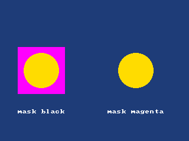

<!-- AUTOGENERATED COPYRIGHT HEADER START -->
<!-- Copyright (C) 2026 Claude <noreply@anthropic.com> -->
<!-- AUTOGENERATED COPYRIGHT HEADER END -->
<!-- Generated by tools/wiki/wiki.py. Edit tools/wiki/text/ instead of this file. -->


# MaskImage

<div align="center">

[Command Index](Command-Index) · [BlitzBasic](BlitzBasic) · [Images](BlitzBasic-Images)

</div>


```blitzbasic
MaskImage:Void image:Int32, red:Int32, green:Int32, blue:Int32
```

| Parameter | Mode | Type | Default | Description |
|---|---|---|---|---|
| `image` | In | Int32 | required | The image. |
| `red` | In | Int32 | required | Red part of the mask color, 0 to 255. |
| `green` | In | Int32 | required | Green part of the mask color, 0 to 255. |
| `blue` | In | Int32 | required | Blue part of the mask color, 0 to 255. |

## Description

Chooses the color that [DrawImage](DrawImage) leaves out when it draws the image. The default is black. Setting a color that the picture does not contain makes every pixel visible, which is how to show black pixels. [DrawBlock](DrawBlock) ignores the mask.

## Examples

```blitzbasic
Graphics 320, 240, 0, 2
SetBuffer BackBuffer()
Local img = CreateImage(80, 80)
SetBuffer ImageBuffer(img)
Color 255, 0, 255
Rect 0, 0, 80, 80, 1
Color 255, 220, 0
Oval 10, 10, 60, 60, 1
SetBuffer BackBuffer()
Cls
Color 30, 60, 120
Rect 0, 0, 320, 240, 1
DrawImage img, 30, 80
MaskImage img, 255, 0, 255
DrawImage img, 190, 80
Color 255, 255, 255
Text 70, 190, "mask black", 1, 1
Text 230, 190, "mask magenta", 1, 1
Flip
WaitKey
```

## Media



## Related Commands

[CopyImage](CopyImage), [CreateImage](CreateImage), [DrawImage](DrawImage), [FreeImage](FreeImage), [GrabImage](GrabImage), [HandleImage](HandleImage), [LoadAnimImage](LoadAnimImage), [LoadImage](LoadImage)

<div align="center">

[Command Index](Command-Index) · [BlitzBasic](BlitzBasic) · [Images](BlitzBasic-Images)

</div>
