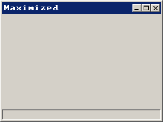

<!-- AUTOGENERATED COPYRIGHT HEADER START -->
<!-- Copyright (C) 2026 Claude <noreply@anthropic.com> -->
<!-- AUTOGENERATED COPYRIGHT HEADER END -->
<!-- Generated by tools/wiki/wiki.py. Edit tools/wiki/text/ instead of this file. -->
# MaximizeWindow 

<div align="center">

[Command Index](Command-Index) · [BlitzPlus](BlitzPlus) · [Windows](BlitzPlus-Windows)

</div>


```blitzbasic
MaximizeWindow:Void window:Int32
```

| Parameter | Mode | Type | Default | Description |
|---|---|---|---|---|
| `window` | In | Int32 | required | Handle of a window. |

## Description

Makes a window as big as the desktop. [RestoreWindow](RestoreWindow) brings back the size it had before, and [WindowMaximized](WindowMaximized) says whether it is in this state.

## Differences

* The operating system maximizes the window, also when it was made without flag 2 and so cannot be resized by the user; without a window manager nothing happens. Where the windows are drawn inside the window of `Graphics`, the window fills that.

## Examples

```blitzbasic
Graphics 320, 240, 32, 2
win = CreateWindow("Maximized", 40, 40, 160, 100, Desktop(), 15)
MaximizeWindow win
Repeat
Until WaitEvent() = $803
```

## Media



## Related Commands

[ActivateWindow](ActivateWindow) , [ActiveWindow](ActiveWindow) , [CreateWindow](CreateWindow) , [MinimizeWindow](MinimizeWindow) , [RestoreWindow](RestoreWindow) , [SetMinWindowSize](SetMinWindowSize) , [SetWindowSizeLimit](SetWindowSizeLimit) , [UpdateWindowMenu](UpdateWindowMenu) 

<div align="center">

[Command Index](Command-Index) · [BlitzPlus](BlitzPlus) · [Windows](BlitzPlus-Windows)

</div>
