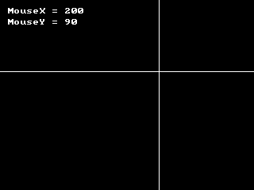

<!-- AUTOGENERATED COPYRIGHT HEADER START -->
<!-- Copyright (C) 2026 Claude <noreply@anthropic.com> -->
<!-- AUTOGENERATED COPYRIGHT HEADER END -->
<!-- Generated by tools/wiki/wiki.py. Edit tools/wiki/text/ instead of this file. -->
# MouseX 

<div align="center">

[Command Index](Command-Index) · [BlitzBasic](BlitzBasic) · [Mouse](BlitzBasic-Mouse)

</div>


```blitzbasic
MouseX:Int32
```

**Returns:** The horizontal position of the pointer.

## Description

The horizontal position of the pointer in the graphics buffer, from 0 on the left to `GraphicsWidth() - 1`. When the window is scaled, the position is converted back to buffer pixels. [MoveMouse](MoveMouse) sets it. BlitzPlus programs can also pass a canvas handle to get the position relative to that canvas.

## Differences

* The Device argument is a BlitzLLVM extension: the original has no such argument and only knows one mouse.

## Examples

```blitzbasic
Graphics 320, 240, 0, 2
SetBuffer BackBuffer()
MoveMouse 200, 90
Cls
Color 255, 255, 255
Line MouseX(), 0, MouseX(), 239
Line 0, MouseY(), 319, MouseY()
Text 10, 10, "MouseX = " + MouseX()
Text 10, 24, "MouseY = " + MouseY()
Flip
WaitKey
```

## Media



## Related Commands

[MouseChanged](MouseChanged) , [MouseDeviceConnected](MouseDeviceConnected) , [MouseDeviceCount](MouseDeviceCount) , [MouseDeviceName](MouseDeviceName) , [MouseDown](MouseDown) , [MouseHit](MouseHit) , [MouseWait](MouseWait) , [MouseXSpeed](MouseXSpeed) 

<div align="center">

[Command Index](Command-Index) · [BlitzBasic](BlitzBasic) · [Mouse](BlitzBasic-Mouse)

</div>
