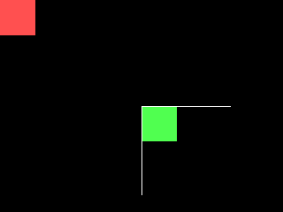

<!-- AUTOGENERATED COPYRIGHT HEADER START -->
<!-- Copyright (C) 2026 Claude <noreply@anthropic.com> -->
<!-- AUTOGENERATED COPYRIGHT HEADER END -->
<!-- Generated by tools/wiki/wiki.py. Edit tools/wiki/text/ instead of this file. -->
# Origin 

<div align="center">

[Command Index](Command-Index) · [BlitzBasic](BlitzBasic) · [Drawing](BlitzBasic-Drawing)

</div>


```blitzbasic
Origin:Void x:Int32, y:Int32
```

| Parameter | Mode | Type | Default | Description |
|---|---|---|---|---|
| `x` | In | Int32 | required | Horizontal position of the new origin in the buffer. |
| `y` | In | Int32 | required | Vertical position of the new origin in the buffer. |

## Description

Moves the point that counts as 0, 0 for everything you draw after it. Shapes, text and images move with it, the viewport does not.

## Examples

```blitzbasic
Graphics 320, 240, 0, 2
SetBuffer BackBuffer()
Cls
Color 255, 80, 80
Rect 0, 0, 40, 40, 1
Origin 160, 120
Color 80, 255, 80
Rect 0, 0, 40, 40, 1
Color 255, 255, 255
Line -100, 0, 100, 0
Line 0, -100, 0, 100
Flip
WaitKey
```

## Media



## Related Commands

[GetColor](GetColor) , [Line](Line) , [Oval](Oval) , [Plot](Plot) 

<div align="center">

[Command Index](Command-Index) · [BlitzBasic](BlitzBasic) · [Drawing](BlitzBasic-Drawing)

</div>
