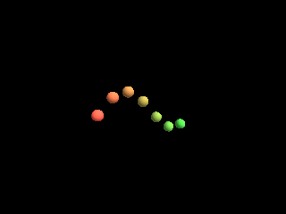

<!-- AUTOGENERATED COPYRIGHT HEADER START -->
<!-- Copyright (C) 2026 Claude <noreply@anthropic.com> -->
<!-- AUTOGENERATED COPYRIGHT HEADER END -->
<!-- Generated by tools/wiki/wiki.py. Edit tools/wiki/text/ instead of this file. -->


# PositionEntity

<div align="center">

[Command Index](Command-Index) · [Blitz3D](Blitz3D) · [Entities](Blitz3D-Entities)

</div>


```blitzbasic
PositionEntity:Void entity:Int32, x:Float32, y:Float32, z:Float32, global:Int32=0
```

| Parameter | Mode | Type | Default | Description |
|---|---|---|---|---|
| `entity` | In | Int32 | required | Entity handle. |
| `x` | In | Float32 | required | X position. |
| `y` | In | Float32 | required | Y position. |
| `z` | In | Float32 | required | Z position. |
| `global` | In | Int32 | `0` | 1 to use the world position instead of one relative to the parent. Defaults to 0. |

## Description

Puts an entity at a position. Without `global` the position is relative to the parent, or to the world when there is no parent. With `global` set to 1 it is a world position, whatever the parents are. New entities start at 0, 0, 0. X grows to the right, Y grows up and Z grows into the screen.

## Examples

```blitzbasic
Graphics3D 320, 240, 0, 2
SetBuffer BackBuffer()
camera = CreateCamera()
PositionEntity camera, 0, 3, -9
RotateEntity camera, 15, 0, 0
light = CreateLight()
RotateEntity light, 45, 45, 0
For i = 0 To 6
	ball = CreateSphere(12)
	ScaleEntity ball, 0.4, 0.4, 0.4
	PositionEntity ball, i - 3, Sin(i * 50) * 1.5, i * 0.3
	EntityColor ball, 255 - i * 30, 90 + i * 20, 70
Next
RenderWorld
Flip
WaitKey
```

## Media



## Related Commands

[CopyEntity](CopyEntity), [FreeEntity](FreeEntity), [HideEntity](HideEntity), [MoveEntity](MoveEntity), [NameEntity](NameEntity), [PaintEntity](PaintEntity), [PointEntity](PointEntity), [RotateEntity](RotateEntity)

<div align="center">

[Command Index](Command-Index) · [Blitz3D](Blitz3D) · [Entities](Blitz3D-Entities)

</div>
