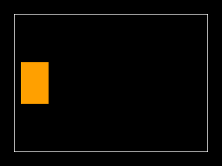

<!-- AUTOGENERATED COPYRIGHT HEADER START -->
<!-- Copyright (C) 2026 Claude <noreply@anthropic.com> -->
<!-- AUTOGENERATED COPYRIGHT HEADER END -->
<!-- Generated by tools/wiki/wiki.py. Edit tools/wiki/text/ instead of this file. -->
# Rect   

<div align="center">

[Command Index](Command-Index) · [BlitzBasic](BlitzBasic) · [Drawing](BlitzBasic-Drawing)

</div>


```blitzbasic
Rect:Void x:Int32, y:Int32, width:Int32, height:Int32, solid:Int32=1
```

| Parameter | Mode | Type | Default | Description |
|---|---|---|---|---|
| `x` | In | Int32 | required | Horizontal position of the left side. |
| `y` | In | Int32 | required | Vertical position of the top. |
| `width` | In | Int32 | required | Width in pixels. |
| `height` | In | Int32 | required | Height in pixels. |
| `solid` | In | Int32 | `1` | 1 fills the rectangle, 0 draws only the outline. Defaults to 1. |

## Description

Draws a rectangle.

## Examples

```blitzbasic
Graphics 320, 240, 0, 2
SetBuffer BackBuffer()
For frame = 0 To 59
	Cls
	Color 255, 255, 255
	Rect 20, 20, 280, 200, 0
	Color 255, 160, 0
	Rect 30 + frame * 3, 90, 40, 60, 1
	Flip
Next
```

## Media



## Related Commands

[Oval](Oval)   , [Plot](Plot)   , [ScanLine](ScanLine)   , [Viewport](Viewport)   

<div align="center">

[Command Index](Command-Index) · [BlitzBasic](BlitzBasic) · [Drawing](BlitzBasic-Drawing)

</div>
