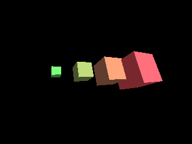

<!-- AUTOGENERATED COPYRIGHT HEADER START -->
<!-- Copyright (C) 2026 Claude <noreply@anthropic.com> -->
<!-- AUTOGENERATED COPYRIGHT HEADER END -->
<!-- Generated by tools/wiki/wiki.py. Edit tools/wiki/text/ instead of this file. -->
# ScaleEntity 

<div align="center">

[Command Index](Command-Index) · [Blitz3D](Blitz3D) · [Entities](Blitz3D-Entities)

</div>


```blitzbasic
ScaleEntity:Void entity:Int32, x_scale:Float32, y_scale:Float32, z_scale:Float32, global:Int32=0
```

| Parameter | Mode | Type | Default | Description |
|---|---|---|---|---|
| `entity` | In | Int32 | required | Entity handle. |
| `x_scale` | In | Float32 | required | Size along X. |
| `y_scale` | In | Float32 | required | Size along Y. |
| `z_scale` | In | Float32 | required | Size along Z. |
| `global` | In | Int32 | `0` | 1 to scale independent of the parent. Defaults to 0. |

## Description

Sets the size of an entity as a factor for each axis. 1 is the size it was made with, 2 doubles it, 0.5 halves it and 0 makes it flat so it vanishes. A negative factor mirrors the entity along that axis. Scaling a parent scales its children with it.

## Examples

```blitzbasic
Graphics3D 320, 240, 0, 2
SetBuffer BackBuffer()
camera = CreateCamera()
PositionEntity camera, 0, 0, -9
light = CreateLight()
RotateEntity light, 45, 45, 0
For i = 0 To 3
	cube = CreateCube()
	PositionEntity cube, i * 2.5 - 3.75, 0, 0
	TurnEntity cube, 20, 30, 0
	ScaleEntity cube, 0.4 + i * 0.3, 0.4 + i * 0.3, 0.4 + i * 0.3
	EntityColor cube, 90 + i * 50, 200 - i * 40, 90
Next
RenderWorld
Flip
WaitKey
```

## Media



## Related Commands

[CopyEntity](CopyEntity) , [FreeEntity](FreeEntity) , [HideEntity](HideEntity) , [MoveEntity](MoveEntity) , [NameEntity](NameEntity) , [PaintEntity](PaintEntity) , [PointEntity](PointEntity) , [PositionEntity](PositionEntity) 

<div align="center">

[Command Index](Command-Index) · [Blitz3D](Blitz3D) · [Entities](Blitz3D-Entities)

</div>
