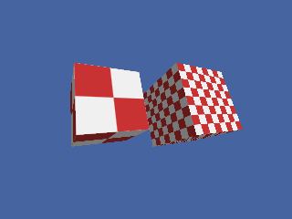

<!-- AUTOGENERATED COPYRIGHT HEADER START -->
<!-- Copyright (C) 2026 Claude <noreply@anthropic.com> -->
<!-- AUTOGENERATED COPYRIGHT HEADER END -->
<!-- Generated by tools/wiki/wiki.py. Edit tools/wiki/text/ instead of this file. -->


# ScaleTexture

<div align="center">

[Command Index](Command-Index) · [Blitz3D](Blitz3D) · [Textures](Blitz3D-Textures)

</div>


```blitzbasic
ScaleTexture texture:Int32, u_scale:Float32, v_scale:Float32
```

| Parameter | Type | Default | Description |
|---|---|---|---|
| `texture` | Int32 | required | The texture to scale. |
| `u_scale` | Float32 | required | Horizontal size factor. 1 is unchanged, 2 is twice as wide. |
| `v_scale` | Float32 | required | Vertical size factor. |

## Description

Sets how large the texture appears on a surface. Values above 1 enlarge the image, so it repeats less often; values below 1 shrink it, so it repeats more often. The call replaces the previous scale, and every entity that uses the texture is affected at once.

## Examples

```blitzbasic
Graphics3D 320, 240, 0, 2
SetBuffer BackBuffer()
camera = CreateCamera()
CameraClsColor camera, 70, 100, 160
light = CreateLight()
RotateEntity light, 40, 30, 0

tex = CreateTexture(64, 64)
SetBuffer TextureBuffer(tex)
ClsColor 240, 240, 240
Cls
Color 200, 50, 50
Rect 0, 0, 32, 32, 1
Rect 32, 32, 32, 32, 1
SetBuffer BackBuffer()

a = CreateCube() : PositionEntity a, -1.4, 0, 5 : TurnEntity a, 20, 30, 0
b = CreateCube() : PositionEntity b, 1.4, 0, 5 : TurnEntity b, 20, 30, 0
EntityTexture a, tex
tex2 = CreateTexture(64, 64)
SetBuffer TextureBuffer(tex2)
ClsColor 240, 240, 240
Cls
Color 200, 50, 50
Rect 0, 0, 32, 32, 1
Rect 32, 32, 32, 32, 1
SetBuffer BackBuffer()
ScaleTexture tex2, 0.25, 0.25
EntityTexture b, tex2
RenderWorld
Flip
WaitKey
```

## Media



## Related Commands

[ClearTextureFilters](ClearTextureFilters), [CreateTexture](CreateTexture), [FreeTexture](FreeTexture), [LoadAnimTexture](LoadAnimTexture), [LoadTexture](LoadTexture), [PositionTexture](PositionTexture), [RotateTexture](RotateTexture), [SetTextureSampler](SetTextureSampler) 〔BlitzLLVM〕

<div align="center">

[Command Index](Command-Index) · [Blitz3D](Blitz3D) · [Textures](Blitz3D-Textures)

</div>
