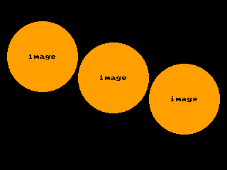

<!-- AUTOGENERATED COPYRIGHT HEADER START -->
<!-- Copyright (C) 2026 Claude <noreply@anthropic.com> -->
<!-- AUTOGENERATED COPYRIGHT HEADER END -->
<!-- Generated by tools/wiki/wiki.py. Edit tools/wiki/text/ instead of this file. -->


# SetBuffer

<div align="center">

[Command Index](Command-Index) · [BlitzBasic](BlitzBasic) · [Buffers and Pixels](BlitzBasic-Buffers-and-Pixels)

</div>


```blitzbasic
SetBuffer buffer:Int32
```

| Parameter | Type | Default | Description |
|---|---|---|---|
| `buffer` | Int32 | required | A buffer from [BackBuffer](BackBuffer), [FrontBuffer](FrontBuffer), [ImageBuffer](ImageBuffer) or `TextureBuffer`. |

## Description

Chooses where drawing commands such as `Rect`, `Text`, [DrawImage](DrawImage) and `Plot` draw to: the back buffer, the front buffer, or the buffer of an image or texture. A program usually calls `SetBuffer BackBuffer()` once after `Graphics`. Switching the buffer puts the [Origin](Origin) and the viewport back to their defaults and the text cursor of `Print` to the top left corner.

## Differences

* A buffer that does not exist stops the program with an error message.

## Examples

```blitzbasic
Graphics 320, 240, 0, 2
SetBuffer BackBuffer()
Local img = CreateImage(100, 100)
SetBuffer ImageBuffer(img)
Color 255, 160, 0
Oval 0, 0, 100, 100, 1
Color 0, 0, 0
Text 50, 50, "image", 1, 1
SetBuffer BackBuffer()
Cls
For i = 0 To 2
	DrawImage img, 10 + i * 100, 30 + i * 30
Next
Flip
WaitKey
```

## Media



## Related Commands

[BackBuffer](BackBuffer), [BufferDirty](BufferDirty), [FrontBuffer](FrontBuffer), [GraphicsBuffer](GraphicsBuffer), [LoadBuffer](LoadBuffer), [LockBuffer](LockBuffer), [SaveBuffer](SaveBuffer), [UnlockBuffer](UnlockBuffer)

<div align="center">

[Command Index](Command-Index) · [BlitzBasic](BlitzBasic) · [Buffers and Pixels](BlitzBasic-Buffers-and-Pixels)

</div>
