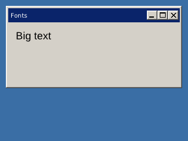

<!-- AUTOGENERATED COPYRIGHT HEADER START -->
<!-- Copyright (C) 2026 Claude <noreply@anthropic.com> -->
<!-- AUTOGENERATED COPYRIGHT HEADER END -->
<!-- Generated by tools/wiki/wiki.py. Edit tools/wiki/text/ instead of this file. -->
# SetGadgetFont 

<div align="center">

[Command Index](Command-Index) · [BlitzPlus](BlitzPlus) · [Gadgets](BlitzPlus-Gadgets)

</div>


```blitzbasic
SetGadgetFont:Void gadget:Int32, font:Int32
```

| Parameter | Mode | Type | Default | Description |
|---|---|---|---|---|
| `gadget` | In | Int32 | required | Handle of the gadget. |
| `font` | In | Int32 | required | Font handle from `LoadFont` or [RequestFont](RequestFont). |

## Description

Makes a gadget draw its text with another font.

## Differences

* The gadget is drawn with the typeface of the font, and its text is measured in the widths of that font. A font that was not found on the system is drawn with the built-in bitmap font in the size that was asked for.

## Examples

```blitzbasic
Graphics 320, 240, 32, 2
win = CreateWindow("Fonts", 10, 10, 300, 140, Desktop(), 3)
big = LoadFont("Arial", 20)
lab = CreateLabel("Big text", 10, 10, 250, 40, win)
SetGadgetFont lab, big
Repeat
Until WaitEvent() = $803
```

## Media



## Related Commands

[GadgetFont](GadgetFont) , [SetButtonState](SetButtonState) , [SetGadgetLayout](SetGadgetLayout) , [SetGadgetShape](SetGadgetShape) , [SetGadgetText](SetGadgetText) , [SetPanelColor](SetPanelColor) , [SetPanelImage](SetPanelImage) , [SetSliderRange](SetSliderRange) 

<div align="center">

[Command Index](Command-Index) · [BlitzPlus](BlitzPlus) · [Gadgets](BlitzPlus-Gadgets)

</div>
