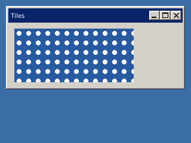

<!-- AUTOGENERATED COPYRIGHT HEADER START -->
<!-- Copyright (C) 2026 Claude <noreply@anthropic.com> -->
<!-- AUTOGENERATED COPYRIGHT HEADER END -->
<!-- Generated by tools/wiki/wiki.py. Edit tools/wiki/text/ instead of this file. -->
# SetPanelImage 

<div align="center">

[Command Index](Command-Index) · [BlitzPlus](BlitzPlus) · [Gadgets](BlitzPlus-Gadgets)

</div>


```blitzbasic
SetPanelImage:Void panel:Int32, file:String
```

| Parameter | Mode | Type | Default | Description |
|---|---|---|---|---|
| `panel` | In | Int32 | required | Handle of a panel. |
| `file` | In | String | required | Name of a picture file. |

## Description

Shows a picture from a file in a panel. If the panel is bigger than the picture it is repeated like tiles.

## Examples

```blitzbasic
Graphics 320, 240, 32, 2
tile = CreateImage(16, 16)
SetBuffer ImageBuffer(tile)
Color 40, 90, 160
Rect 0, 0, 16, 16, 1
Color 255, 255, 255
Oval 4, 4, 8, 8, 1
SaveImage tile, "tile.bmp"
SetBuffer BackBuffer()
win = CreateWindow("Tiles", 10, 10, 300, 140, Desktop(), 3)
p   = CreatePanel(10, 10, 200, 90, win)
SetPanelImage p, "tile.bmp"
Repeat
Until WaitEvent() = $803
```

## Media



## Related Commands

[SetButtonState](SetButtonState) , [SetGadgetFont](SetGadgetFont) , [SetGadgetLayout](SetGadgetLayout) , [SetGadgetShape](SetGadgetShape) , [SetGadgetText](SetGadgetText) , [SetPanelColor](SetPanelColor) , [SetSliderRange](SetSliderRange) , [SetSliderValue](SetSliderValue) 

<div align="center">

[Command Index](Command-Index) · [BlitzPlus](BlitzPlus) · [Gadgets](BlitzPlus-Gadgets)

</div>
