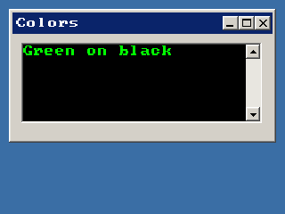

<!-- AUTOGENERATED COPYRIGHT HEADER START -->
<!-- Copyright (C) 2026 Claude <noreply@anthropic.com> -->
<!-- AUTOGENERATED COPYRIGHT HEADER END -->
<!-- Generated by tools/wiki/wiki.py. Edit tools/wiki/text/ instead of this file. -->
# SetTextAreaColor 

<div align="center">

[Command Index](Command-Index) · [BlitzPlus](BlitzPlus) · [Text Areas](BlitzPlus-Text-Areas)

</div>


```blitzbasic
SetTextAreaColor:Void textarea:Int32, red:Int32, green:Int32, blue:Int32, background:Int32=0
```

| Parameter | Mode | Type | Default | Description |
|---|---|---|---|---|
| `textarea` | In | Int32 | required | Handle of a text area. |
| `red` | In | Int32 | required | Red part, 0 to 255. |
| `green` | In | Int32 | required | Green part, 0 to 255. |
| `blue` | In | Int32 | required | Blue part, 0 to 255. |
| `background` | In | Int32 | `0` | 0 sets the text color, 1 sets the background color. Defaults to 0. |

## Description

Sets the color of the text, or with the last parameter the color of the background, of the whole text area.

## Examples

```blitzbasic
Graphics 320, 240, 32, 2
win  = CreateWindow("Colors", 10, 10, 300, 150, Desktop(), 3)
area = CreateTextArea(10, 10, 270, 90, win)
SetGadgetText area, "Green on black"
SetTextAreaColor area, 0, 0, 0, 1
SetTextAreaColor area, 0, 255, 0
Repeat
Until WaitEvent() = $803
```

## Media



## Related Commands

[AddTextAreaText](AddTextAreaText) , [CreateTextArea](CreateTextArea) , [FormatTextAreaText](FormatTextAreaText) , [LockTextArea](LockTextArea) , [SetTextAreaFont](SetTextAreaFont) , [SetTextAreaTabs](SetTextAreaTabs) , [SetTextAreaText](SetTextAreaText) , [TextAreaChar](TextAreaChar) 

<div align="center">

[Command Index](Command-Index) · [BlitzPlus](BlitzPlus) · [Text Areas](BlitzPlus-Text-Areas)

</div>
