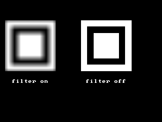

<!-- AUTOGENERATED COPYRIGHT HEADER START -->
<!-- Copyright (C) 2026 Claude <noreply@anthropic.com> -->
<!-- AUTOGENERATED COPYRIGHT HEADER END -->
<!-- Generated by tools/wiki/wiki.py. Edit tools/wiki/text/ instead of this file. -->
# TFormFilter 

<div align="center">

[Command Index](Command-Index) · [BlitzBasic](BlitzBasic) · [Images](BlitzBasic-Images)

</div>


```blitzbasic
TFormFilter:Void enable:Int32
```

| Parameter | Mode | Type | Default | Description |
|---|---|---|---|---|
| `enable` | In | Int32 | required | True for smooth results (the default), False for the nearest pixel. |

## Description

Chooses how [TFormImage](TFormImage), [ScaleImage](ScaleImage) and [RotateImage](RotateImage) look pixels up. With the filter on, the colors of neighboring pixels are blended for a smooth result. With it off, the nearest pixel is taken, which keeps hard edges and is the right choice for pixel art.

## Examples

```blitzbasic
Graphics 320, 240, 0, 2
SetBuffer BackBuffer()
Local img = CreateImage(8, 8)
SetBuffer ImageBuffer(img)
Color 255, 255, 255
Rect 0, 0, 8, 8, 0
Rect 2, 2, 4, 4, 1
SetBuffer BackBuffer()
TFormFilter True
Local smooth = CopyImage(img)
ScaleImage smooth, 12.5, 12.5
TFormFilter False
Local sharp = CopyImage(img)
ScaleImage sharp, 12.5, 12.5
Cls
DrawBlock smooth, 10, 40
DrawBlock sharp, 160, 40
Color 255, 255, 255
Text 60, 160, "filter on", 1, 1
Text 210, 160, "filter off", 1, 1
Flip
WaitKey
```

## Media



## Related Commands

[SavesPending](SavesPending) , [ScaleImage](ScaleImage) , [TFormImage](TFormImage) , [TileBlock](TileBlock) 

<div align="center">

[Command Index](Command-Index) · [BlitzBasic](BlitzBasic) · [Images](BlitzBasic-Images)

</div>
