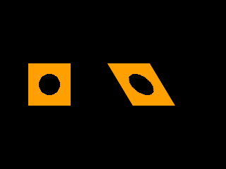

<!-- AUTOGENERATED COPYRIGHT HEADER START -->
<!-- Copyright (C) 2026 Claude <noreply@anthropic.com> -->
<!-- AUTOGENERATED COPYRIGHT HEADER END -->
<!-- Generated by tools/wiki/wiki.py. Edit tools/wiki/text/ instead of this file. -->
# TFormImage 

<div align="center">

[Command Index](Command-Index) · [BlitzBasic](BlitzBasic) · [Images](BlitzBasic-Images)

</div>


```blitzbasic
TFormImage:Void image:Int32, a:Float32, b:Float32, c:Float32, d:Float32
```

| Parameter | Mode | Type | Default | Description |
|---|---|---|---|---|
| `image` | In | Int32 | required | The image. |
| `a` | In | Float32 | required | Horizontal part of the first column of the matrix. |
| `b` | In | Float32 | required | Vertical part of the first column of the matrix. |
| `c` | In | Float32 | required | Horizontal part of the second column of the matrix. |
| `d` | In | Float32 | required | Vertical part of the second column of the matrix. |

## Description

Transforms every frame of an image with a 2x2 matrix. With the values `a, b, c, d` a point `(x, y)` of the picture, measured from the handle, goes to `(a*x + c*y, b*x + d*y)`. The matrix `a=1, b=0, c=0.6, d=1` tilts the picture to the right, and [ScaleImage](ScaleImage) and [RotateImage](RotateImage) are special cases. The image becomes as large as the result needs.

## Differences

* A matrix that cannot be inverted (for example `a=0, b=0`) stops the program with an error message.

## Examples

```blitzbasic
Graphics 320, 240, 0, 2
SetBuffer BackBuffer()
Local img = CreateImage(60, 60)
SetBuffer ImageBuffer(img)
Color 255, 160, 0
Rect 0, 0, 60, 60, 1
Color 0, 0, 0
Oval 15, 15, 30, 30, 1
SetBuffer BackBuffer()
Local tilted = CopyImage(img)
MidHandle tilted
TFormImage tilted, 1, 0, 0.6, 1
Cls
DrawImage img, 40, 90
DrawImage tilted, 200, 120
Flip
WaitKey
```

## Media



## Related Commands

[CopyImage](CopyImage) , [CreateImage](CreateImage) , [DrawImage](DrawImage) , [FreeImage](FreeImage) , [GrabImage](GrabImage) , [HandleImage](HandleImage) , [LoadAnimImage](LoadAnimImage) , [TFormFilter](TFormFilter) 

<div align="center">

[Command Index](Command-Index) · [BlitzBasic](BlitzBasic) · [Images](BlitzBasic-Images)

</div>
